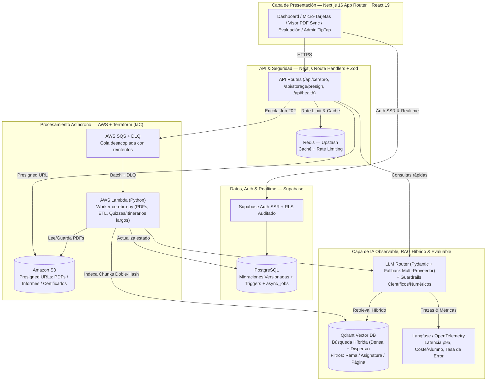

# 🧠 CONTEXT.md — Documento Maestro y Estrella Polar de Alquimia LMS

> **Plataforma EdTech Interactiva de Ciencias de la Salud y Ciencias Exactas (Medicina, Nutrición, Química, Bioquímica y Física) impulsada por IA Observable, RAG Híbrido (Qdrant), Micro-Learning y Arquitectura Híbrida (Next.js + Supabase + AWS)**
> *Fuente única de verdad para desarrolladores, revisores técnicos y agentes IA.*

---

## 1. Identidad, Propósito y Visión del Producto

### ¿Qué es Alquimia LMS?
**Alquimia LMS** es una plataforma educativa interactiva diseñada para el estudio riguroso de **ciencias aplicadas y ciencias de la salud** —abarcando **Medicina, Nutrición y Dietética (vertical piloto actual), Química, Bioquímica, Física** y disciplinas científicas afines.

A diferencia de un chat genérico con IA sobre apuntes, el dominio científico exige **cero tolerancia a alucinaciones numéricas, de unidades o de dosificación** (`mg`, `µg`, `kcal`, `mol/L`, `m/s²`, constantes físicas/clínicas) y una pedagogía activa orientada a la retención real:
- **Micro-learning por tarjetas interactivas** con subrayado, resúmenes estructurados y sincronización con libros/PDFs de referencia.
- **Tutoría IA proactiva ("Profesor Alquimia")** anclada a evidencia bibliográfica (`[[REFS:...]]`) y disparada ante bloqueos reales del alumno (p. ej. trigger SQL tras 3 fallos consecutivos).
- **Evaluación adaptativa** con validación de esquemas estrictos y guardrails de integridad numérica/científica.

### Doble Objetivo del Proyecto
1. **Objetivo de Producto (EdTech Científico):** Construir una plataforma fiable, rápida y afinada para el estudio de ramas científicas y médicas, capaz de ingerir bibliografía pesada (PDFs técnicos), estructurarla en micro-lecciones y evaluar con precisión verificable.
2. **Objetivo de Ingeniería (Arquitectura Nivel Producción / Mid 45k€):** Evolucionar el sistema desde un prototipo síncrono hacia una **plataforma distribuida, asíncrona, observable, segura y testeada** con infraestructura declarada como código (Terraform en AWS), control estricto de costes de IA y calidad automatizada en CI/CD.

---

## 2. Arquitectura: Estado Actual (*As-Is*) vs. Estado Objetivo (*To-Be*)

### Estado Actual (*As-Is*)
- **Frontend & BFF:** Next.js 16 (App Router) + React 19 + TypeScript estricto + Tailwind CSS v4 + Zustand / Nano Stores + TipTap (editor docente) + PDF.js (visor sincronizado).
- **Datos, Auth y Realtime:** Supabase (Auth SSR con `@supabase/ssr` y middleware, PostgreSQL con esquemas `public` y `nutricionista`, triggers PL/pgSQL y Realtime).
- **Motor IA / ETL (`cerebro-py`):** Microservicio Python (FastAPI + Pydantic v2 + PyMuPDF + `pytest`) con extracción de PDFs, generación de quizzes, flujo ETL (`flows/etl_ingest_flow.py`) y guardrail de integridad numérica clínica (`services/guardrails.py`).
- **Limitación actual:** Las llamadas desde `src/app/api/cerebro/route.ts` hacia `cerebro-py` son **síncronas por HTTP** (timeout 8s) y dependen aún de un webhook legacy en **n8n** como fallback (timeout 15s).
- **Estado de `n8n`:** **DEPRECADO (en fase de retirada).** Se mantiene únicamente como fallback transitorio en Fase 0 y será eliminado por completo al completarse las Fases 1 y 2 en favor de código propio versionado, observable y testeable (`cerebro-py` + AWS SQS/Lambda + LLM Router).

### Arquitectura Objetivo (*To-Be* — Fin de Fase 4)



---

## 3. Principios Arquitectónicos e Invariantes No Negociables

1. **Rigor Científico y Guardrails Deterministas:** Toda salida de IA que incluya cifras, dosis o unidades científicas debe validarse mediante contratos estrictos (**Zod** en TypeScript / **Pydantic** en Python) y guardrails deterministas (`guardrails.py`) respaldados por una suite automatizada de Evals.
2. **Desacoplamiento de Cargas Pesadas:** Ningún procesamiento de PDFs, ingesta ETL o generación de itinerarios/evaluaciones extensas puede bloquear una ruta HTTP síncrona de Next.js. Toda tarea larga pasa por **S3 + SQS/DLQ + Lambda Python**.
3. **Retirada Total de `n8n`:** Toda orquestación de IA y procesamiento de datos debe vivir en código versionado en Git, testeable con `pytest`/`vitest` y observable con trazas estructuradas (sin lógica crítica oculta en flujos no-code externos).
4. **Seguridad por Defecto (Zero Trust en Datos):** 100% de las tablas de Supabase con **Row Level Security (RLS)** habilitado y migraciones versionadas en `supabase/migrations/`. IAM en AWS bajo **mínimo privilegio** (sin comodines `*`).
5. **Infraestructura Reproducible y FinOps Disciplinado:** Toda la infraestructura AWS se declara en **Terraform (`infra/`)** con un objetivo de coste operativo de **0–2 €/mes (AWS Free Tier)** y alertas de presupuesto.
6. **Observabilidad y Decisiones Basadas en Datos:** No se optimiza a ciegas. Cada fase se contrasta contra la línea base cuantitativa de la Fase 0 (latencia p95, tasa de error/timeout, coste por alumno y score de Evals).
7. **Separación de Persistencia (Relacional vs. Vectorial):** **Supabase (PostgreSQL)** gestiona identidad (Auth SSR), permisos (RLS), estado relacional y Realtime; **Qdrant** gestiona la recuperación semántica/híbrida de bibliografía científica (vectores densos + dispersos + filtros de payload por rama/asignatura/página) con indexación idempotente por doble hash.

---

## 4. Mapa Real del Repositorio

```text
lmsalquimia/
├── src/
│   ├── app/                        # Next.js 16 App Router (páginas + API Routes)
│   │   ├── admin/                  # Panel docente (TipTap, calendario, gestión)
│   │   ├── api/                    # Route Handlers (cerebro, admin/*, v1/integrations/*)
│   │   ├── biblioteca/             # Explorador de bibliografía y recursos
│   │   ├── calendario/             # Calendario académico
│   │   ├── dashboard/              # Centro de mando del estudiante
│   │   ├── evaluacion/             # Motor de cuestionarios adaptativos
│   │   ├── historial/              # Historial de estudio y consultas
│   │   ├── leccion/[...path]/      # Visor dinámico de lecciones por micro-tarjetas
│   │   ├── login/ & auth/callback/ # Autenticación Supabase SSR
│   │   └── planificacion/          # Cronograma Gantt de estudio
│   ├── components/                 # UI modular (lesson/, pdf/, quiz/, admin/)
│   ├── lib/                        # Capa de datos, Supabase SSR, pdfSync, tracking, auth
│   ├── store/                      # Estado global Zustand (chatStore, quizStore, uiStore)
│   └── types/                      # Tipos TypeScript de base de datos
├── cerebro-py/                     # Microservicio / Core Python (FastAPI + Pydantic + PyMuPDF)
│   ├── flows/                      # Pipelines ETL (etl_ingest_flow.py)
│   ├── schemas/                    # Contratos Pydantic (quiz.py, dataset.py)
│   ├── services/                   # PDF extractor/cleaner, chunker, quiz, chat, guardrails.py
│   └── tests/                      # Suite unitaria Pytest
├── supabase/                       # Esquema SQL (evolucionará a supabase/migrations/ + RLS)
├── docs/
│   ├── architecture/               # [Fase 4] Registro de Decisiones Técnicas (decisions.md)
│   ├── assets/                     # [Fase 4] Capturas verificables (UI, CI/Evals, Health/Infra)
│   └── estrategia/                 # Guías de arquitectura e Implementation Plans (Fases 0–4)
├── .github/workflows/              # Pipelines CI/CD en GitHub Actions
├── infra/                          # [Fase 1] Terraform AWS (S3, SQS, DLQ, Lambda, IAM)
├── scripts/                        # [Fase 0+] Scripts de benchmark baseline y utilidades
├── ai_prompt.md                    # System prompt del Profesor Alquimia
├── AGENTS.md                       # Reglas obligatorias del proyecto (incluye control Git)
└── CONTEXT.md                      # Este documento maestro
```

---

## 5. Hoja de Ruta Estratégica (Fases 0–4)

| Fase | Enfoque Principal | Estado | Documentación |
| :--- | :--- | :--- | :--- |
| **Fase 0** | Saneamiento legacy (Astro), Baseline cuantitativo, `.env.example`, CI Quick Win y `README.md` v1 | **Completada** | [Estrategia](docs/estrategia/fase-0-saneamiento-baseline/fase-0-saneamiento-baseline.md) · [Implementation Plan](docs/estrategia/fase-0-saneamiento-baseline/implementation-plan.md) · [Baseline](docs/estrategia/fase-0-saneamiento-baseline/baseline-metrics.md) |
| **Fase 1** | Backend Asíncrono en AWS (S3 Presigned + SQS/DLQ + Lambda Python) + Terraform + IAM mínimo privilegio | **Implementada (local)** | [Estrategia](docs/estrategia/fase-1-backend-asincrono-aws-terraform/fase-1-backend-asincrono-aws-terraform.md) · [Implementation Plan](docs/estrategia/fase-1-backend-asincrono-aws-terraform/fase-1-implementation-plan.md) |
| **Fase 2** | Ingeniería de IA Observable y Evaluable (Zod/Pydantic + Fallback Multi-LLM + **Qdrant RAG Híbrido** + Redis + Langfuse + 28 Evals + retirada definitiva de `n8n`) | **Implementada (local)** | [Estrategia](docs/estrategia/fase-2-ingenieria-ia-observable-evaluable/fase-2-ingenieria-ia-observable-evaluable.md) · [Implementation Plan](docs/estrategia/fase-2-ingenieria-ia-observable-evaluable/fase-2-implementation-plan.md) |
| **Fase 3** | Seguridad, Datos y Calidad de Producción (RLS auditado + `supabase/migrations/` + Vitest/Pytest/Playwright en CI + `/api/health` + logs JSON) | **Implementada (local)** | [Estrategia](docs/estrategia/fase-3-seguridad-datos-calidad-produccion/fase-3-seguridad-datos-calidad-produccion.md) · [Implementation Plan](docs/estrategia/fase-3-seguridad-datos-calidad-produccion/fase-3-implementation-plan.md) |
| **Fase 4** | Presentación de Ingeniería CTO-Ready (`README.md` definitivo, ADRs de Trade-offs y métricas reales *Antes vs. Después*) | **Implementada (local)** | [Estrategia](docs/estrategia/fase-4-presentacion-ingenieria-cto/fase-4-presentacion-ingenieria-cto.md) · [Implementation Plan](docs/estrategia/fase-4-presentacion-ingenieria-cto/fase-4-implementation-plan.md) · [ADRs](docs/architecture/decisions.md) |

---

## 6. Convenciones de Trabajo y Reglas de Agentes

- **Metodología de desarrollo:** Todo Implementation Plan y ejecución de código sigue la skill [`skills/code-refinement-suite/SKILL.md`](skills/code-refinement-suite/SKILL.md) (clasificación adaptativa de complejidad, Plan con Roadmap de checkboxes y verificación fáctica antes de cerrar).
- **Control de versiones (Regla mandatoria en `AGENTS.md`):** **NUNCA ejecutar `git push` automáticamente.** Siempre presentar resumen de cambios y resultados de pruebas y solicitar confirmación explícita del usuario.
- **Mantenimiento de este documento:** Al finalizar cada fase, actualizar la tabla de la Sección 5 y sincronizar el estado *As-Is* para que `CONTEXT.md` nunca vuelva a quedarse desfasado.
