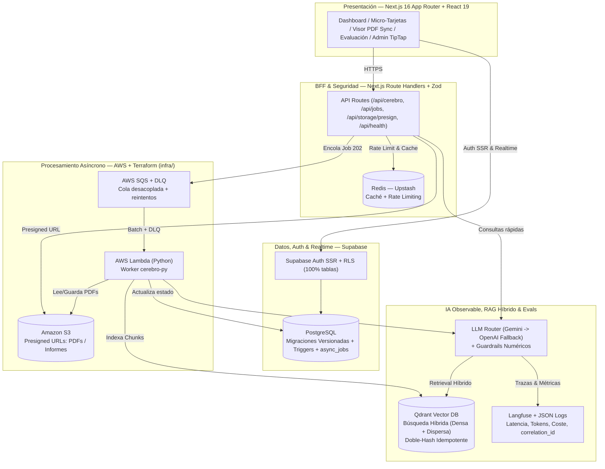
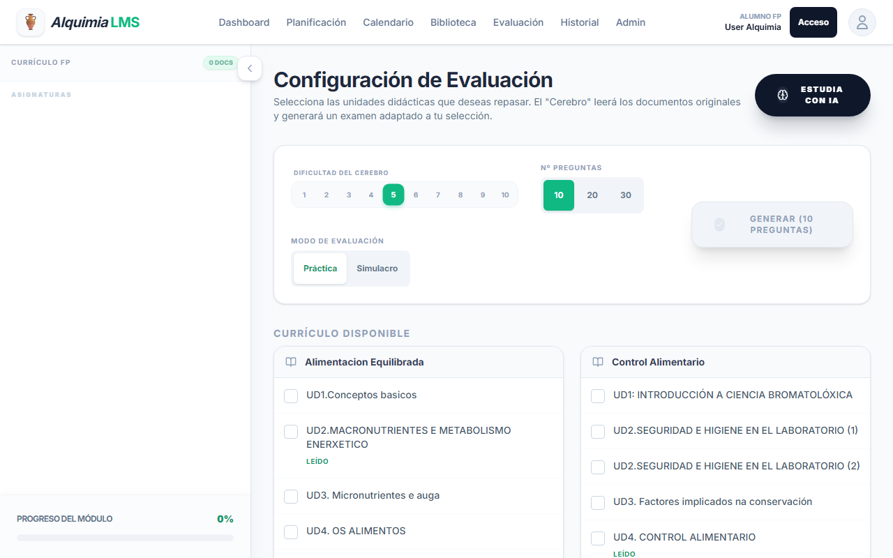
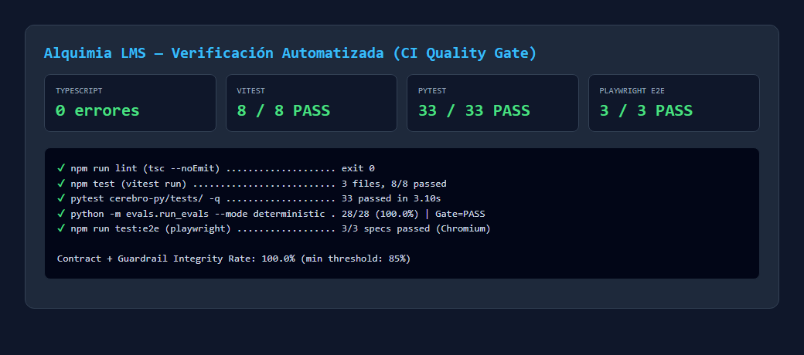
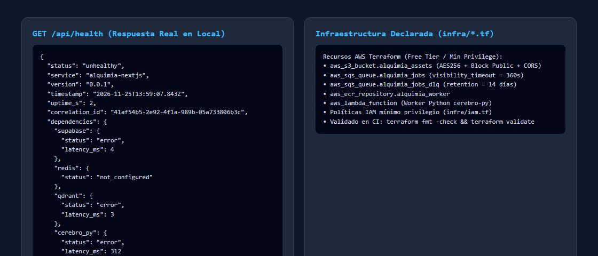

# Alquimia LMS

[](https://github.com/KIWIONER/lmsalquimia/actions/workflows/ci.yml)


**Plataforma EdTech Interactiva de Ciencias de la Salud y Ciencias Exactas** (Medicina, Nutrición y Dietética como vertical piloto, Química, Bioquímica y Física) impulsada por micro-learning por tarjetas, visor PDF sincronizado, evaluaciones adaptativas y una arquitectura híbrida observable con tolerancia cero a alucinaciones numéricas o clínicas.

> **Documento Maestro:** [`CONTEXT.md`](./CONTEXT.md) · **Decisiones y Trade-offs:** [`docs/architecture/decisions.md`](./docs/architecture/decisions.md)

---

## 1. Problema que Resuelve y Dominio

En formación científica y sanitaria, un chatbot genérico sobre PDFs es insuficiente e inseguro: un error en unidades (`mg` vs. `µg`, `kcal`, `mol/L`, `UI`) o en dosis clínicas invalida el aprendizaje. **Alquimia LMS** combina:
- **Micro-learning activo:** tarjetas estructuradas, subrayado, visor PDF sincronizado y tutoría proactiva disparada por trigger SQL ante bloqueos del alumno.
- **Rigor determinista:** validación estricta de contratos (**Zod** + **Pydantic v2**), guardrails de integridad numérica (`guardrails.py`) y una suite bloqueante de **28 Evals** en CI.
- **Arquitectura desacoplada:** ingesta de PDFs y cargas pesadas fuera del hilo HTTP mediante **S3 Presigned URLs + SQS/DLQ + AWS Lambda Python** declarados en Terraform.

---

## 2. Arquitectura Completa



---

## 3. Métricas Reales (*Antes vs. Después*)

Comparativa trazable entre la línea base capturada en Fase 0 ([`baseline-metrics.md`](./docs/estrategia/fase-0-saneamiento-baseline/baseline-metrics.md)) y el estado verificado tras completar las Fases 1–3:

| Dimensión | Antes (Fase 0 — Baseline) | Después (Fases 1–3 Verificadas) | Fuente / Evidencia |
| :--- | :--- | :--- | :--- |
| **Ejecución de tareas pesadas** | 100% síncrona (corte HTTP 8s en `cerebro-py`, 15s en `n8n` legacy) | Asíncrona `202 Accepted` vía **S3 + SQS/DLQ + Lambda**; `n8n` retirado | [`infra/main.tf`](./infra/main.tf) · [`src/app/api/jobs/route.ts`](./src/app/api/jobs/route.ts) |
| **Capa vectorial (RAG)** | `0%` persistencia (`_memory_store` en memoria) | **Qdrant** búsqueda híbrida (densa + dispersa) e idempotencia doble-hash | [`vector_repository.py`](./cerebro-py/services/vector_repository.py) · [`hash_manager.py`](./cerebro-py/services/hash_manager.py) |
| **Seguridad de datos (RLS)** | Sin `ENABLE ROW LEVEL SECURITY` en `schema.sql` | `100%` tablas (`public` y `nutricionista`) con RLS + matriz auditada | [`supabase/RLS_MATRIX.md`](./supabase/RLS_MATRIX.md) · [`2026112503_rls_policies.sql`](./supabase/migrations/2026112503_rls_policies.sql) |
| **Suite de Evals e Integridad** | `0%` Evals automatizados | **28/28 (100.0%)** en gate determinista; **100.0%** contratos + guardrails | [`cerebro-py/evals/last_report.json`](./cerebro-py/evals/last_report.json) |
| **Testing & CI/CD** | 0 tests JS/E2E; CI básico | **Vitest (8/8)** + **Pytest (33/33)** + **Playwright (3/3)** + Terraform check | [`.github/workflows/ci.yml`](./.github/workflows/ci.yml) |
| **Observabilidad y Salud** | `0%` trazas; sin `/api/health`; coste estimado por `chars / 4` | `/api/health` granular, logs JSON con `correlation_id` y **Langfuse** instrumentado | [`src/app/api/health/route.ts`](./src/app/api/health/route.ts) · [`observability.py`](./cerebro-py/services/observability.py) |

> **Nota de transparencia:** La latencia de referencia en Fase 0 (`p95 = 291 ms` en quiz y `1573 ms` en chat sobre `n = 10` peticiones locales síncronas) se tomó antes de introducir el desacople SQS/Lambda. Las métricas de *cache hit* en Redis y costes acumulados de Langfuse dependen de credenciales cloud activas (el sistema degrada de forma segura en local cuando no están configuradas).

---

## 4. Decisiones de Arquitectura y Trade-offs (ADRs)

Resumen de las 6 decisiones documentadas en detalle en [`docs/architecture/decisions.md`](./docs/architecture/decisions.md):

| ADR | Decisión Elegida | Alternativa Descartada | Trade-off Asumido |
| :--- | :--- | :--- | :--- |
| **ADR-001** | **AWS SQS + DLQ + Lambda** | API Routes síncronas / `n8n` | Mayor complejidad de estado (`async_jobs` + polling/Realtime) |
| **ADR-002** | **Híbrido (Next.js + Supabase + AWS)** | 100% AWS o 100% Supabase | Dos planos de credenciales (RLS vs. IAM) y latencia entre nubes |
| **ADR-003** | **Redis + LLM Router + Langfuse** | Llamada directa a un único LLM | Dependencia de servicios externos (mitigada con degradación elegante) |
| **ADR-004** | **Guardrails + Zod/Pydantic + 28 Evals** | Solo Prompt Engineering | Mayor fricción al cambiar formatos de salida (exige actualizar contratos/evals) |
| **ADR-005** | **S3 Presigned URLs** | Proxy binario en Next.js | Configuración de CORS y lifecycle rules en S3 (`uploads/tmp/`) |
| **ADR-006** | **Qdrant (RAG Híbrido)** | `pgvector` en Supabase | Servicio adicional y sincronización idempotente mediante doble hash |

---

## 5. Evidencias Verificables

| Interfaz de Evaluación Adaptativa (`/evaluacion`) | Quality Gate Automatizado (CI + Evals) |
| :---: | :---: |
|  |  |

| Salud del Sistema (`GET /api/health`) e Infraestructura Terraform (`infra/*.tf`) |
| :---: |
|  |

---

## 6. Quickstart Reproducible

### Requisitos
- **Node.js** `>= 22.12.0`
- **Python** `>= 3.12`
- *(Opcional para cloud)* Credenciales de Supabase, Upstash Redis, Qdrant, AWS y Langfuse en `.env.local` (ver [`.env.example`](./.env.example)).

### 1. Instalación y arranque en local
```bash
cp .env.example .env.local
npm ci
npm run setup:py
npm run dev:all
```
- **Frontend y BFF (Next.js):** `http://localhost:3100`
- **Motor Python (`cerebro-py`):** `http://127.0.0.1:8155/health`

### 2. Validación completa (mismos checks que CI)
```bash
# TypeScript + Vitest + Build Next.js
npm run lint
npm test
npm run build

# Tests unitarios Python + Gate determinista de Evals (28 casos)
PYTHONPATH=cerebro-py pytest cerebro-py/tests/ -q
PYTHONPATH=cerebro-py python -m evals.run_evals --mode deterministic

# Tests E2E Playwright (usa PORT alternativo si 3100 ya está ocupado)
npm run test:e2e

# Validación Terraform (desde infra/)
cd infra && terraform fmt -check && terraform init -backend=false && terraform validate
```

---

## 7. Roadmap de Ingeniería (Fases 0–4)

| Fase | Enfoque Principal | Estado | Documentación |
| :--- | :--- | :--- | :--- |
| **Fase 0** | Saneamiento legacy, deprecación `n8n`, CI Quick Win y línea base cuantitativa | Completada | [Estrategia](docs/estrategia/fase-0-saneamiento-baseline/fase-0-saneamiento-baseline.md) · [Plan](docs/estrategia/fase-0-saneamiento-baseline/implementation-plan.md) · [Baseline](docs/estrategia/fase-0-saneamiento-baseline/baseline-metrics.md) |
| **Fase 1** | Backend Asíncrono en AWS (S3 Presigned + SQS/DLQ + Lambda) + Terraform | Implementada (local) | [Estrategia](docs/estrategia/fase-1-backend-asincrono-aws-terraform/fase-1-backend-asincrono-aws-terraform.md) · [Plan](docs/estrategia/fase-1-backend-asincrono-aws-terraform/fase-1-implementation-plan.md) |
| **Fase 2** | IA Observable y Evaluable (LLM Router + Qdrant RAG Híbrido + Redis + Langfuse + 28 Evals) | Implementada (local) | [Estrategia](docs/estrategia/fase-2-ingenieria-ia-observable-evaluable/fase-2-ingenieria-ia-observable-evaluable.md) · [Plan](docs/estrategia/fase-2-ingenieria-ia-observable-evaluable/fase-2-implementation-plan.md) |
| **Fase 3** | Seguridad, Datos y Calidad (RLS 100% + Migraciones + Vitest/Pytest/Playwright + `/api/health`) | Implementada (local) | [Estrategia](docs/estrategia/fase-3-seguridad-datos-calidad-produccion/fase-3-seguridad-datos-calidad-produccion.md) · [Plan](docs/estrategia/fase-3-seguridad-datos-calidad-produccion/fase-3-implementation-plan.md) |
| **Fase 4** | Presentación CTO-Ready (`README.md` definitivo, 6 ADRs y evidencias verificables) | Implementada (local) | [Estrategia](docs/estrategia/fase-4-presentacion-ingenieria-cto/fase-4-presentacion-ingenieria-cto.md) · [Plan](docs/estrategia/fase-4-presentacion-ingenieria-cto/fase-4-implementation-plan.md) · [ADRs](docs/architecture/decisions.md) |
