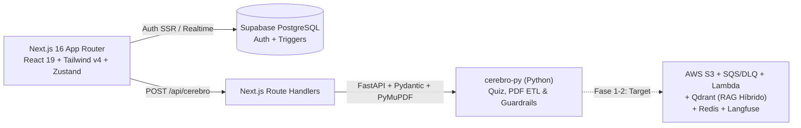

# Alquimia LMS

**Plataforma EdTech Interactiva de Ciencias de la Salud y Ciencias Exactas** (Medicina, Nutrición y Dietética como vertical piloto, Química, Bioquímica y Física), impulsada por micro-learning por tarjetas, visor PDF sincronizado, evaluaciones adaptativas y un motor de IA orientado a rigor científico.

> **Documento Maestro del Proyecto:** [`CONTEXT.md`](./CONTEXT.md)

---

## Arquitectura (Estado Actual y Evolución)

Actualmente el sistema opera con **Next.js 16 (App Router) + Supabase SSR/Realtime + `cerebro-py` (FastAPI/Pydantic/PyMuPDF)** y se encuentra en ejecución de un plan estructurado de 5 fases hacia una arquitectura híbrida de producción (**AWS S3/SQS/Lambda + Terraform + Qdrant RAG Híbrido + Redis + Langfuse**), retirando progresivamente el fallback legacy de `n8n`.



---

## Stack Tecnológico Actual

| Capa | Tecnología | Rol |
| :--- | :--- | :--- |
| **Frontend & BFF** | Next.js 16 (App Router), React 19, TypeScript, Tailwind CSS v4 | UI modular (dashboard, micro-tarjetas, visor PDF sync, evaluación, admin TipTap) y API Routes. |
| **Estado UI** | Zustand, Nano Stores, Framer Motion | Estado de chat tutor, motor de quiz e interfaz interactiva. |
| **Datos & Auth** | Supabase (`@supabase/ssr`, PostgreSQL, Realtime) | Autenticación SSR, almacenamiento relacional y alertas proactivas por trigger SQL. |
| **Motor IA / ETL** | Python 3.12, FastAPI, Pydantic v2, PyMuPDF, Pytest (`cerebro-py/`) | Extracción/limpieza de PDFs, generación de evaluaciones y guardrails de integridad numérica clínica (`guardrails.py`). |
| **CI/CD** | GitHub Actions (`.github/workflows/deploy.yml`) | Validación de tipos (`tsc --noEmit`), build determinista (`npm ci` + `next build`) y tests unitarios (`pytest`). |

---

## Arranque Rápido en Local

### Requisitos
- **Node.js** `>= 22.12.0`
- **Python** `>= 3.12`

### 1. Instalación inicial (una sola vez)
```bash
cp .env.example .env.local
npm ci
npm run setup:py
```
- Completa al menos las credenciales de Supabase en `.env.local`.
- `npm run setup:py` crea automáticamente `cerebro-py/.venv` e instala `cerebro-py/requirements.txt` (compatible con Windows, macOS y Linux).

### 2. Levantar todo el entorno local (recomendado)
```bash
npm run dev:all
```
Arranca en una sola terminal ambos servicios con logs prefijados y cierre limpio (`Ctrl+C`):
- **Frontend y API (Next.js):** `http://localhost:3100`
- **Motor Python (`cerebro-py`):** `http://127.0.0.1:8155/health`

### 3. Arranque individual (opcional)
```bash
# Solo Frontend / API Next.js
npm run dev

# Solo Motor Python (cerebro-py)
npm run dev:py
```

### 4. Validación y Benchmark Baseline
```bash
# Type-check y build Next.js
npm run lint
npm run build

# Tests unitarios Python
PYTHONPATH=cerebro-py pytest cerebro-py/tests -v

# Captura de línea base de rendimiento (con Next.js y cerebro-py activos)
node scripts/benchmark_baseline.mjs
```

---

## Roadmap de Arquitectura (Fases 0–4)

| Fase | Objetivo Principal | Documentación |
| :--- | :--- | :--- |
| **Fase 0** | Saneamiento técnico, deprecación de `n8n`, CI Quick Win y línea base cuantitativa | [Estrategia](docs/estrategia/fase-0-saneamiento-baseline/fase-0-saneamiento-baseline.md) · [Implementation Plan](docs/estrategia/fase-0-saneamiento-baseline/implementation-plan.md) |
| **Fase 1** | Backend Asíncrono en AWS (S3 Presigned + SQS/DLQ + Lambda Python) + Terraform + IAM mínimo privilegio | [Estrategia](docs/estrategia/fase-1-backend-asincrono-aws-terraform.md) |
| **Fase 2** | Ingeniería de IA Observable y Evaluable (Zod/Pydantic + Fallback Multi-LLM + **Qdrant RAG Híbrido** + Redis + Langfuse + 25–30 Evals) | [Estrategia](docs/estrategia/fase-2-ingenieria-ia-observable-evaluable.md) |
| **Fase 3** | Seguridad, Datos y Calidad de Producción (RLS auditado + `supabase/migrations/` + Vitest/Pytest/Playwright + `/api/health` + logs JSON) | [Estrategia](docs/estrategia/fase-3-seguridad-datos-calidad-produccion.md) |
| **Fase 4** | Presentación CTO-Ready (`README.md` definitivo, ADRs de Trade-offs y métricas reales *Antes vs. Después*) | [Estrategia](docs/estrategia/fase-4-presentacion-ingenieria-cto.md) |
