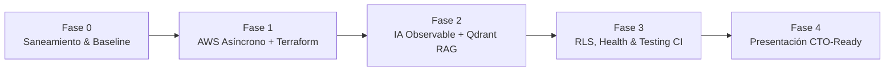

# Estrategia de Ingeniería y Evolución Arquitectónica — Alquimia LMS

> **Propósito de esta carpeta:** Documentar de principio a fin el proceso estratégico que transformó **Alquimia LMS** desde un prototipo síncrono con persistencia en memoria hacia una **plataforma híbrida de nivel producción** (`Next.js 16 + Supabase + AWS + Qdrant + CI/CD`), trazable en cada decisión, métrica y prueba.

---

## 1. Visión General del Proceso (Fases 0–4)

Todo el rediseño técnico se ejecutó de forma incremental en **5 fases**, aplicando en cada etapa la metodología [`code-refinement-suite`](../../skills/code-refinement-suite/SKILL.md) (*Ideación ToT + Panel de Expertos → Planificación con Roadmap → Implementación CoVe/TDD → Auditoría y Verificación*):

### Principios que guiaron el proceso
1. **Medir antes de optimizar:** La Fase 0 congeló una línea base cuantitativa ([`baseline-metrics.md`](./fase-0-saneamiento-baseline/baseline-metrics.md)) para contrastar cada mejora posterior con datos reales.
2. **Desacoplar lo pesado y retirar lógica opaca:** Retirar `n8n` y mover ingesta de PDFs/ETL fuera del hilo HTTP de Next.js hacia **S3 + SQS/DLQ + Lambda Python**.
3. **Rigor científico y tolerancia cero a alucinaciones:** Contratos estrictos (**Zod** / **Pydantic v2**), guardrails numéricos deterministas (`guardrails.py`) y gate bloqueante de **28 Evals** en CI.
4. **Seguridad y FinOps por defecto:** **RLS al 100%** en Supabase, IAM de mínimo privilegio en AWS, alerta de presupuesto a `5 USD` y destrucción/creación reproducible con Terraform.

---

## 2. Índice y Resumen por Fase

| Fase | Carpeta | Enfoque Principal | Documentos |
| :--- | :--- | :--- | :--- |
| **Fase 0** | `fase-0-saneamiento-baseline/` | Limpieza legacy, deprecación de `n8n`, `.env.example` y línea base | [Estrategia](./fase-0-saneamiento-baseline/fase-0-saneamiento-baseline.md) · [Plan](./fase-0-saneamiento-baseline/implementation-plan.md) · [Baseline](./fase-0-saneamiento-baseline/baseline-metrics.md) |
| **Fase 1** | `fase-1-backend-asincrono-aws-terraform/` | S3 Presigned URLs, SQS + DLQ, Lambda Python (ECR) e IaC Terraform | [Estrategia](./fase-1-backend-asincrono-aws-terraform/fase-1-backend-asincrono-aws-terraform.md) · [Plan](./fase-1-backend-asincrono-aws-terraform/fase-1-implementation-plan.md) |
| **Fase 2** | `fase-2-ingenieria-ia-observable-evaluable/` | LLM Router (fallback), Qdrant RAG Híbrido, Redis, Langfuse y 28 Evals | [Estrategia](./fase-2-ingenieria-ia-observable-evaluable/fase-2-ingenieria-ia-observable-evaluable.md) · [Plan](./fase-2-ingenieria-ia-observable-evaluable/fase-2-implementation-plan.md) |
| **Fase 3** | `fase-3-seguridad-datos-calidad-produccion/` | Migraciones SQL + RLS 100%, `/api/health`, logs JSON y Vitest/Pytest/Playwright | [Estrategia](./fase-3-seguridad-datos-calidad-produccion/fase-3-seguridad-datos-calidad-produccion.md) · [Plan](./fase-3-seguridad-datos-calidad-produccion/fase-3-implementation-plan.md) |
| **Fase 4** | `fase-4-presentacion-ingenieria-cto/` | `README.md` CTO-ready, 6 ADRs con trade-offs y evidencias en `docs/assets/` | [Estrategia](./fase-4-presentacion-ingenieria-cto/fase-4-presentacion-ingenieria-cto.md) · [Plan](./fase-4-presentacion-ingenieria-cto/fase-4-implementation-plan.md) |

---

## 3. Evolución Técnica Paso a Paso

### Fase 0 — Saneamiento y Línea Base Cuantitativa
- **Qué resolvía:** Existían restos legacy de Astro, lógica crítica dependiente de `n8n` (timeout 15s) y ausencia de métricas de referencia o `.env.example`.
- **Resultado:** Repositorio limpio sobre **Next.js 16 + `cerebro-py`**, puertos unificados (`3100` / `8155`), script reproducible [`scripts/benchmark_baseline.mjs`](../../scripts/benchmark_baseline.mjs) y fotografía inicial documentada (`0%` caché, `0%` Vector DB persistente, `0%` Evals).

### Fase 1 — Backend Asíncrono en AWS y Terraform (IaC)
- **Qué resolvía:** Las rutas API de Next.js cortaban a 8s contra `cerebro-py` y transferían binarios por el backend.
- **Resultado:** Infraestructura declarada en [`infra/`](../../infra/README.md) (bucket S3 privado con CORS y lifecycle de 7 días para `uploads/tmp/`, cola SQS + DLQ, ECR con retención de 3 imágenes, Lambda Python, CloudWatch Logs e IAM de mínimo privilegio), tabla `public.async_jobs` y endpoints `/api/storage/presign` y `/api/jobs`.
- **Validación real en cuenta AWS (`eu-west-1`):** Al desplegar en entorno real se afianzaron 4 detalles clave:
  1. `limit_unit = "USD"` en AWS Budgets (`EUR` no está soportado por la API).
  2. `scaling_config { maximum_concurrency = 5 }` en el trigger SQS→Lambda (compatible con la cuota inicial de cuentas nuevas).
  3. `--platform linux/amd64 --provenance=false` en `docker build` para evitar índices OCI rechazados por Lambda.
  4. Inclusión explícita de `config.py` en [`cerebro-py/Dockerfile.lambda`](../../cerebro-py/Dockerfile.lambda).

### Fase 2 — Ingeniería de IA Observable, RAG Híbrido y Evaluable
- **Qué resolvía:** Dependencia de un único proveedor LLM, falta de control de abuso/costes, RAG volátil en memoria (`_memory_store`) y cero evaluación automatizada.
- **Resultado:**
  - **LLM Router** ([`llm_router.py`](../../cerebro-py/services/llm_router.py)) con proveedor primario Gemini y fallback automático OpenAI.
  - **Qdrant RAG Híbrido** ([`vector_repository.py`](../../cerebro-py/services/vector_repository.py)) combinando búsqueda densa + dispersa para terminología y unidades científicas (`mg`, `µg`, `mol/L`, `ATP`), con idempotencia por doble hash ([`hash_manager.py`](../../cerebro-py/services/hash_manager.py)).
  - **Redis (Upstash)** para caché y rate limiting, trazabilidad **Langfuse** ([`observability.py`](../../cerebro-py/services/observability.py)), guardrails deterministas ([`guardrails.py`](../../cerebro-py/services/guardrails.py)) y suite de **28 Evals** (`100%` PASS).

### Fase 3 — Seguridad, Datos y Calidad de Producción
- **Qué resolvía:** Tablas en Supabase sin RLS habilitado, falta de pirámide de testing en frontend/E2E y ausencia de logs JSON estructurados o endpoint de salud.
- **Resultado:**
  - Migraciones cronológicas en [`supabase/migrations/`](../../supabase/migrations/2026112503_rls_policies.sql) con **RLS en el 100% de tablas** y matriz auditada en [`supabase/RLS_MATRIX.md`](../../supabase/RLS_MATRIX.md).
  - Logger JSON con `correlation_id` (Next.js y Python) + [`/api/health`](../../src/app/api/health/route.ts) multi-dependencia.
  - Pirámide completa en [`.github/workflows/ci.yml`](../../.github/workflows/ci.yml): **Vitest** (`8/8`), **Pytest** (`33/33`), **Evals** (`28/28`), **Playwright E2E** (`3/3`) y validación **Terraform**.

### Fase 4 — Presentación de Ingeniería CTO-Ready y ADRs
- **Qué resolvía:** Hacer visible y defendible todo el criterio arquitectónico en menos de 3 minutos de lectura al abrir el repositorio.
- **Resultado:** [`README.md`](../../README.md) raíz definitivo, 6 ADRs con trade-offs explícitos en [`docs/architecture/decisions.md`](../architecture/decisions.md), evidencias visuales limpias en [`docs/assets/`](../assets), sincronización de [`CONTEXT.md`](../../CONTEXT.md) y blindaje de [`.gitignore`](../../.gitignore).

---

## 4. Guía Rápida de Lectura Según Perfil

- **Si eres CTO / Engineering Manager / Revisor Técnico:** Empieza por el [`README.md`](../../README.md) raíz (lectura < 3 min) y profundiza en [`docs/architecture/decisions.md`](../architecture/decisions.md) para ver los trade-offs reales de cada decisión.
- **Si eres Desarrollador incorporándote al proyecto:** Lee [`CONTEXT.md`](../../CONTEXT.md) como fuente única de verdad, revisa [`infra/README.md`](../../infra/README.md) para desplegar la parte AWS y usa los `*-implementation-plan.md` de cada fase como referencia de diseño y pruebas.
