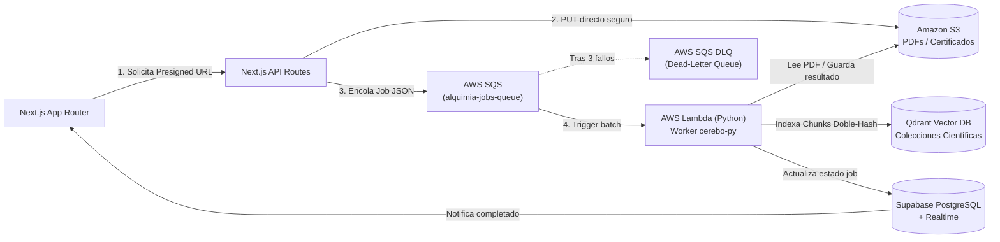

# Fase 1 — Estrategia de Backend Asíncrono en AWS + Terraform (IaC)

> **Guía de Arquitectura · Alquimia LMS (Nivel Mid 45k€)**
> **Objetivo estratégico:** Cerrar la brecha #1 en ofertas Mid/Backend/AI (arquitectura distribuida en AWS, colas desacopladas e Infraestructura como Código).

---

## 1. Propósito

Desacoplar las operaciones pesadas y de larga duración (procesamiento/ingesta de PDFs, generación de itinerarios largos, evaluaciones complejas o informes de progreso) de las rutas HTTP síncronas de Next.js.

Actualmente, `src/app/api/cerebro/route.ts` invoca síncronamente a `cerebro-py` (timeout de 8s) o a n8n (timeout de 15s). En producción, cualquier tarea de IA o extracción PDF que exceda ese margen provoca errores `503`, bloquea la experiencia del alumno y no tiene garantías de reintento ni recuperación ante fallos.

---

## 2. Objetivo a Conseguir

Construir un **flujo serverless asíncrono, reproducible y tolerante a fallos en AWS**, declarado 100% en Terraform y operando dentro de un coste objetivo de **0–2 €/mes (AWS Free Tier)**:

---

## 3. Punto de Partida (Estado Actual Auditado)

- **Lógica Python reutilizable ya existente:** `cerebro-py/services/` ya cuenta con `pdf_extractor.py`, `pdf_cleaner.py`, `chunker.py`, `quiz_service.py`, `qa_generator.py` y `flows/etl_ingest_flow.py`.
- **Acoplamiento actual:** Todo se ejecuta bajo demanda vía HTTP en `cerebro-py/main.py` (`localhost:8055`) llamado desde `src/app/api/cerebro/route.ts` y `src/app/api/admin/upload/route.ts`.
- **Infraestructura ausente:** No existe directorio `infra/`, ni Terraform, ni recursos AWS (S3, SQS, Lambda, IAM).

---

## 4. Requisitos y Alcance (Qué vamos a hacer)

### R1.1 — Almacenamiento Seguro en Amazon S3 con Presigned URLs
- Crear bucket S3 privado (bloqueo total de acceso público, cifrado SSE-S3/AES256 y lifecycle policy para temporales).
- Prefijos lógicos definidos: `uploads/pdfs/`, `generated/certificates/`, `generated/reports/`.
- Implementar en Next.js un endpoint autenticado (`POST /api/storage/presign`) que valide sesión Supabase, tipo MIME y tamaño máximo, y devuelva una **Presigned URL** de subida/descarga con expiración corta (ej. 5 minutos).
- Evitar que los binarios pesados pasen por el servidor de Next.js.

### R1.2 — Cola Asíncrona SQS + Dead-Letter Queue (DLQ)
- Crear cola principal `alquimia-async-jobs` (Standard o FIFO según idempotencia) con:
  - `visibility_timeout_seconds` >= 6× el timeout de la Lambda (ej. 360s si Lambda = 60s).
  - `maxReceiveCount = 3` redirigiendo automáticamente mensajes fallidos a `alquimia-async-jobs-dlq`.
- Definir contrato de mensaje de trabajo (`job_id`, `user_id`, `job_type`, `payload`, `correlation_id`, `created_at`).
- Crear tabla `async_jobs` en Supabase (`id`, `user_id`, `type`, `status` [`pending`|`processing`|`completed`|`failed`], `result_url`, `error_message`, `created_at`, `updated_at`) para que el frontend haga polling ligero o reciba notificación por Supabase Realtime.

### R1.3 — Worker Serverless en AWS Lambda (Python)
- Empaquetar la lógica de dominio de `cerebro-py/services/` (PDF parsing, generación de quizzes largos, informes de progreso) como handler de AWS Lambda (`infra/lambda/` o `cerebro-py/lambda_handler.py`).
- Implementar **idempotencia** por `job_id` (si SQS entrega el mensaje dos veces, no duplicar trabajo ni registros).
- Reportar fallos parciales de lote (`ReportBatchItemFailures`) para no reprocesar mensajes exitosos del mismo batch.

### R1.4 — Infraestructura como Código con Terraform + IAM Mínimo Privilegio
- Crear estructura modular en `infra/`:
  - `infra/main.tf` (recursos S3, SQS, DLQ, Lambda, Event Source Mapping, CloudWatch Log Groups con retención de 14 días para evitar costes).
  - `infra/iam.tf` (roles y políticas **strict least-privilege**: la Lambda solo puede leer de su cola SQS específica, escribir logs en su Log Group y acceder a los prefijos exactos del bucket S3; el usuario/rol de Next.js solo puede `s3:PutObject`/`GetObject` y `sqs:SendMessage`).
  - `infra/variables.tf`, `infra/outputs.tf`, `infra/versions.tf`.
- Documentar en `infra/README.md` el flujo `terraform init`, `terraform plan`, `terraform apply` y `terraform destroy`.

---

## 5. Plan de Evaluación y Criterios de Aceptación (Qué vamos a evaluar)

### Checklist de Verificación

| ID | Criterio de Evaluación | Método de Verificación | Estado Objetivo |
| :--- | :--- | :--- | :--- |
| **EV1.1** | IaC 100% reproducible y válido | `terraform fmt -check`, `terraform validate`, `terraform plan` sin errores ni drift | 0 errores |
| **EV1.2** | Seguridad IAM mínimo privilegio | Revisión de `infra/iam.tf`: cero `"Action": "*"` o `"Resource": "*"` | 100% acotado por ARN |
| **EV1.3** | Subida directa S3 sin acceso público | Intento de GET anónimo al objeto S3 devuelve `403`; subida con Presigned URL devuelve `200` | Verificado |
| **EV1.4** | Flujo asíncrono end-to-end sin bloqueo HTTP | `POST` en Next.js responde `< 300ms` con `202 Accepted` + `job_id`; Lambda completa el job y actualiza Supabase | Respuesta inmediata < 300ms |
| **EV1.5** | Resiliencia y Dead-Letter Queue | Inyectar un payload malformado/fallo forzado → confirmar 3 reintentos y llegada del mensaje a la DLQ | Mensaje visible en DLQ |
| **EV1.6** | Control de costes | Estimación AWS Pricing Calculator + retención de logs CloudWatch configurada + AWS Budget Alert (5 €) | Coste proyectado <= 2 €/mes |

### Definition of Done (DoD)
La Fase 1 está completa cuando al menos un flujo pesado real (p. ej. ingesta/estructuración de PDF o generación de itinerario/quiz extenso) se ejecuta de punta a punta vía `Next.js → S3/SQS → Lambda Python → Supabase`, toda la infraestructura vive en `infra/*.tf` y se ha probado el enrutamiento a DLQ ante fallo.

---

## 6. Riesgos y Mitigaciones

- **Riesgo:** Tamaño de dependencias Python (como `PyMuPDF`) excediendo límites cómodos de zip en Lambda.
  - *Mitigación:* Usar Lambda Layers o imagen Docker en AWS ECR (soporta hasta 10 GB y garantiza paridad local-cloud).
- **Riesgo:** Costes inesperados por loops infinitos de reintentos o logs eternos.
  - *Mitigación:* Configurar `maxReceiveCount = 3`, `reserved_concurrent_executions` bajo (ej. 5), retención CloudWatch a 14 días y AWS Budgets con alerta por email.
