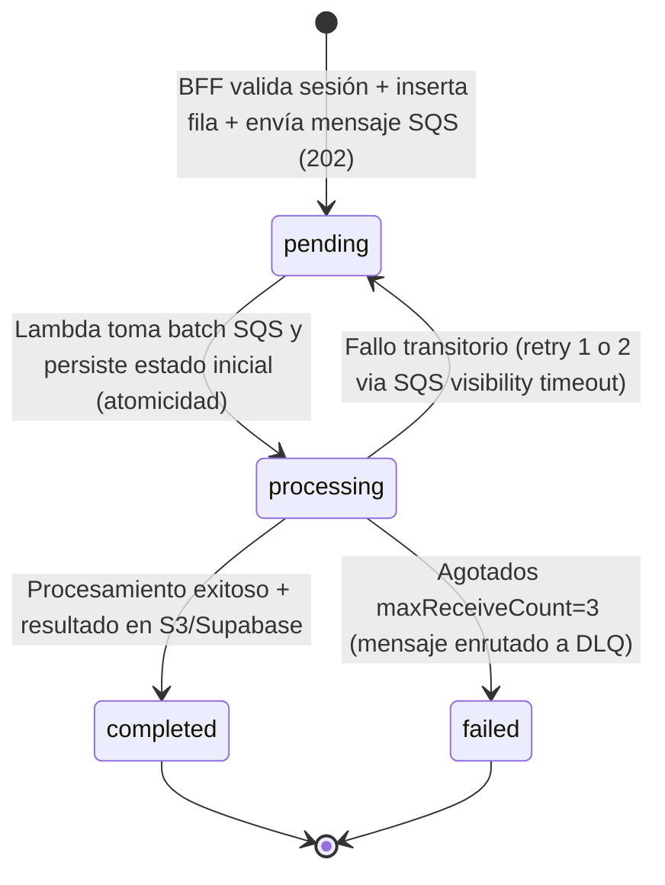

# Implementation Plan — Fase 1: Backend Asíncrono en AWS + Terraform (IaC)

> **Estrategia asociada:** [`fase-1-backend-asincrono-aws-terraform.md`](./fase-1-backend-asincrono-aws-terraform.md)
> **Documento Maestro:** [`CONTEXT.md`](../../../CONTEXT.md)
> **Dominio:** Plataforma EdTech Interactiva de Ciencias de la Salud y Ciencias Exactas (Medicina, Nutrición, Química, Bioquímica y Física)
> **Clasificación Code Refinement Suite:** **Nivel 3 — Complejidad Alta (Arquitectura / Módulo Crítico)** (`PACK_ARCHITECT ➔ PACK_PLANNER ➔ PACK_CODER ➔ PACK_AUDITOR`)

---

## 1. PACK_ARCHITECT: Ideación Técnica (Tree of Thoughts + 3 Expertos)

### Diagnóstico Fáctico de Partida (Verificado en el Codebase)
1. **Rutas HTTP bloqueantes en Next.js:**
   - `src/app/api/cerebro/route.ts` invoca síncronamente a `cerebro-py` (`${cerebroPyUrl}/api/quiz/generate` y `${cerebroPyUrl}/api/chat` con `AbortSignal.timeout(8000)`) y mantiene un fallback legacy `@deprecated` a `n8n` (15s).
   - `src/app/api/admin/upload/route.ts` recibe el archivo completo vía `request.formData()`, lo carga en memoria (`Buffer.from(arrayBuffer)`) y lo sube síncronamente a Supabase Storage.
2. **Lógica Python reutilizable lista para desacoplar:**
   - `cerebro-py/services/pdf_service.py` (`process_pdf_from_url`) ya descarga PDFs por HTTP y los estructura en tarjetas Markdown con `pymupdf` y `pymupdf4llm`.
   - `cerebro-py/services/quiz_service.py` (`generate_adaptive_quiz`) y `cerebro-py/flows/etl_ingest_flow.py` encapsulan generación de quizzes y carga idempotente por doble hash.
3. **Ausencia total de IaC y mensajería:** No existe directorio `infra/`, ni tabla `async_jobs` en `supabase/schema.sql`, ni SDK de AWS en `package.json` o `cerebro-py/requirements.txt`.

### Comparativa Tree of Thoughts (ToT) — Empaquetado y Ejecución del Worker

| Rama Evaluada | Descripción | Ventajas | Riesgos | Coste Mensual Estimado | Decisión |
| :--- | :--- | :--- | :--- | :--- | :--- |
| **Rama A: Zip Lambda + Lambda Layer (`PyMuPDF`)** | Empaquetar handler en `.zip` y `pymupdf`/`pymupdf4llm` en una Lambda Layer compilada para `linux/x86_64` (`manylinux`). | Despliegue rápido sin Docker/ECR; `terraform apply` ligero; arranque frío bajo (~400–700ms). | Límite de 250 MB descomprimido; fricción si crecen dependencias científicas/ML en Fase 2. | **0,00 – 0,50 €** (Free Tier S3/SQS/Lambda) | Descartada para largo plazo |
| **Rama B: AWS Lambda Container Image (ECR)** | `Dockerfile` multi-stage basado en `public.ecr.aws/lambda/python:3.12` reutilizando `cerebro-py/services/`. | **Paridad 100% local-cloud**, soporta hasta **10 GB** (sin límite de `PyMuPDF` ni futuros clientes Qdrant/Langfuse), pruebas locales idénticas con Lambda RIE. | Requiere repositorio ECR en Terraform (límite Free Tier: 500 MB gratis/mes; imágenes >500 MB pagan ~0,10 USD/GB) y cold start algo mayor (~1,5–2,5s). | **0,00 – 1,50 €** (manteniendo imagen < 500 MB con multi-stage slim) | **SELECCIONADA** |
| **Rama C: ECS Fargate / EC2 Worker permanente** | Contenedor siempre encendido haciendo polling a SQS. | Cero cold start. | Coste fijo mínimo ~10–15 €/mes fuera del objetivo FinOps (`<= 2 €/mes`). | ~12,00 – 18,00 € | Descartada por presupuesto |

### Dictamen del Panel de 3 Expertos
- **UX/UI Specialist:** La UI no puede quedarse congelada esperando >8s ni sufrir errores `503`. El flujo debe responder `< 300ms` con `202 Accepted` + `job_id`, mostrar progreso en tiempo real (`pending` → `processing` → `completed` / `failed`) vía Supabase Realtime (con fallback polling) y ofrecer reintento claro en pantalla ante fallos.
- **Dev Lead:** Reutilizar `cerebro-py/services/` sin duplicar lógica de negocio entre FastAPI local y el handler Lambda (`cerebro-py/lambda_handler.py`). Definir contratos estrictos con **Zod** (Next.js) y **Pydantic v2** (Python) para el mensaje SQS y la tabla `async_jobs`.
- **Security Specialist (Sec):**
  - Cero `"Action": "*"` o `"Resource": "*"` en `infra/iam.tf`.
  - Bucket S3 100% privado (`block_public_acls`, `block_public_policy`, `ignore_public_acls`, `restrict_public_buckets`), cifrado AES256, y **Presigned URLs** con expiración de 300s, `ContentType` y rango de tamaño restringidos (`default-deny` para MIME no permitidos).
  - La tabla `async_jobs` en Supabase debe llevar RLS activo desde el día 1: el usuario autenticado solo lee sus propios `job_id`, y solo el `service_role` (worker Lambda / BFF) puede mutar estados.

---

## 2. PACK_PLANNER: Arquitectura de Ejecución y Diseño por Bloques

### Diagrama de Estados e Invariantes (`async_jobs` + SQS/DLQ)

> **Invariante de Persistencia Incremental:** Queda prohibido que el worker solo actualice Supabase al final. Debe persistir `status = 'processing'` (y `started_at` / `attempts`) **al iniciar** el procesamiento del `job_id` antes de ejecutar la carga pesada (`PyMuPDF` / quiz), de modo que cualquier consulta concurrente a BD en mitad de la corrida observe el estado intermedio real.

---

### Bloque A — Infraestructura como Código en Terraform (`infra/`) (R1.1, R1.2, R1.4)

Estructura modular en `infra/`:

| Archivo | Responsabilidad | Detalle Técnico Clave |
| :--- | :--- | :--- |
| `infra/versions.tf` | Versiones y provider | Terraform `>= 1.6`, provider `hashicorp/aws ~> 5.0`, región configurable (`eu-west-1` por defecto, baja latencia España). |
| `infra/variables.tf` | Parámetros | `project_name` (`alquimia-lms`), `environment` (`dev`/`prod`), `aws_region`, `budget_alert_email`, `lambda_image_uri` (opcional/ECR), `supabase_url`, `supabase_service_role_key` (sensitive). |
| `infra/main.tf` | Recursos core | 1. **S3 Bucket** privado (`alquimia-lms-assets-<env>-<account>`): `aws_s3_bucket_public_access_block` todo `true`, SSE-S3 (`AES256`), `aws_s3_bucket_lifecycle_configuration` (expirar `uploads/tmp/` a los 7 días y abortar multipart incompletos a 1 día), CORS acotado al dominio Next.js. 2. **SQS DLQ** (`alquimia-async-jobs-dlq`) con retención 14 días. 3. **SQS Cola Principal** (`alquimia-async-jobs`): `visibility_timeout_seconds = 360` (6× timeout Lambda de 60s), `redrive_policy` con `maxReceiveCount = 3`. 4. **ECR Repository** (`alquimia-cerebro-worker`) con `lifecycle_policy` (mantener solo últimas 3 imágenes para no superar 500 MB Free Tier). 5. **CloudWatch Log Group** (`/aws/lambda/alquimia-cerebro-worker`) con `retention_in_days = 14`. 6. **AWS Lambda** (`alquimia-cerebro-worker`): `package_type = "Image"`, `timeout = 60`, `memory_size = 512`, `reserved_concurrent_executions = 5` (protección anti-loop/coste). 7. **Event Source Mapping** SQS → Lambda con `batch_size = 5` y `function_response_types = ["ReportBatchItemFailures"]`. 8. **AWS Budgets** (`aws_budgets_budget`): alerta mensual a `5 EUR` (umbral 80% y 100%). |
| `infra/iam.tf` | Seguridad mínimo privilegio | - **Rol Lambda (`alquimia_worker_role`):** solo `sqs:ReceiveMessage`, `sqs:DeleteMessage`, `sqs:GetQueueAttributes` sobre el ARN exacto de `alquimia-async-jobs`; `s3:GetObject` sobre `arn:.../uploads/pdfs/*` y `s3:PutObject` sobre `arn:.../generated/*`; `logs:CreateLogStream`, `logs:PutLogEvents` sobre el ARN exacto de su Log Group. - **Usuario/Rol BFF Next.js (`alquimia_bff_user`):** solo `s3:PutObject` / `s3:GetObject` sobre prefijos permitidos (`uploads/pdfs/*`, `generated/*`) y `sqs:SendMessage` sobre el ARN exacto de `alquimia-async-jobs`. Cero `*`. |
| `infra/outputs.tf` | Salidas | `s3_bucket_name`, `sqs_queue_url`, `sqs_dlq_url`, `lambda_function_name`, `ecr_repository_url`. |
| `infra/README.md` | Runbook IaC | Guía paso a paso: `terraform init`, `terraform fmt -check`, `terraform validate`, `terraform plan`, build/push imagen ECR, `terraform apply`, prueba DLQ y `terraform destroy`. |

---

### Bloque B — Base de Datos Supabase: Tabla `async_jobs` + RLS + Realtime (R1.2)

- **Archivo SQL:** Añadir migración versionada en `supabase/migrations/20261124_async_jobs.sql` (y mantener coherencia con `supabase/schema.sql`):
  - Columnas: `id UUID PRIMARY KEY DEFAULT gen_random_uuid()`, `user_id UUID NOT NULL REFERENCES auth.users(id)`, `type TEXT NOT NULL CHECK (type IN ('pdf_structure', 'generate_quiz_long', 'progress_report'))`, `status TEXT NOT NULL DEFAULT 'pending' CHECK (status IN ('pending', 'processing', 'completed', 'failed'))`, `input_key TEXT`, `result_url TEXT`, `result_payload JSONB`, `error_message TEXT`, `attempts INT NOT NULL DEFAULT 0`, `correlation_id TEXT NOT NULL`, `created_at TIMESTAMPTZ NOT NULL DEFAULT now()`, `updated_at TIMESTAMPTZ NOT NULL DEFAULT now()`.
  - Trigger `set_updated_at` automático en `UPDATE`.
  - Índice en `(user_id, created_at DESC)` y `(status)`.
  - **RLS:** `ENABLE ROW LEVEL SECURITY` + política `SELECT` para `auth.uid() = user_id` (los alumnos/docentes solo ven sus jobs; mutaciones reservadas a `service_role`).
  - Habilitar `ALTER PUBLICATION supabase_realtime ADD TABLE public.async_jobs;`.

---

### Bloque C — API BFF en Next.js: Presigned URLs y Encolado Asíncrono (R1.1, R1.2)

Nuevas dependencias en `package.json`: `@aws-sdk/client-s3`, `@aws-sdk/s3-request-presigner`, `@aws-sdk/client-sqs`, `zod` (si no está instalada, verificar antes).

1. **Contratos y Cliente AWS (`src/lib/aws/`):**
   - `src/lib/aws/clients.ts`: singletons lazy para `S3Client` y `SQSClient` con variables `AWS_REGION`, `AWS_ACCESS_KEY_ID`, `AWS_SECRET_ACCESS_KEY`.
   - `src/lib/aws/jobContracts.ts`: esquemas **Zod** estrictos (`default-deny`):
     - `PresignRequestSchema`: `operation` (`"upload" | "download"`), `prefix` (`"uploads/pdfs" | "generated/certificates" | "generated/reports"`), `fileName` (sanitizado, sin `..` ni `/`), `contentType` (whitelist estricta: `application/pdf`), `sizeBytes` (`1 <= sizeBytes <= 25 * 1024 * 1024`).
     - `AsyncJobEnqueueSchema`: `jobType` (`"pdf_structure" | "generate_quiz_long" | "progress_report"`), `payload` discriminado por tipo.
2. **Endpoint Presigned URL (`src/app/api/storage/presign/route.ts`):**
   - Valida sesión autenticada (Supabase SSR o sesión admin según contexto).
   - Valida cuerpo con `PresignRequestSchema` (`400` ante cualquier desvío).
   - Genera `PutObjectCommand` o `GetObjectCommand` con `expiresIn: 300` (5 min) y `ContentType` fijado.
   - Devuelve `{ uploadUrl / downloadUrl, key, expiresIn: 300 }`.
3. **Endpoints de Jobs Asíncronos (`src/app/api/jobs/route.ts` y `src/app/api/jobs/[id]/route.ts`):**
   - `POST /api/jobs`: valida sesión y `AsyncJobEnqueueSchema`, inserta fila `pending` en `async_jobs`, envía mensaje JSON a SQS (`job_id`, `user_id`, `job_type`, `payload`, `correlation_id`, `created_at`) y devuelve **`202 Accepted`** con `{ jobId, status: "pending", correlationId }` en `< 300ms`. Si falla SQS, marca el job como `failed` y devuelve `502`.
   - `GET /api/jobs/[id]`: valida sesión y ownership (`user_id`), devuelve el estado actual del job para polling/hidratación.
4. **Integración no disruptiva en UI / rutas existentes:**
   - Actualizar `.env.example` con el bloque AWS (`AWS_REGION`, `AWS_S3_BUCKET`, `AWS_SQS_QUEUE_URL`, `AWS_ACCESS_KEY_ID`, `AWS_SECRET_ACCESS_KEY`) sin exponer secretos.
   - Mantener compatibilidad en `src/app/api/cerebro/route.ts` para consultas rápidas (<8s) y delegar flujos pesados (`pdf_structure` / `generate_quiz_long`) a `POST /api/jobs`.

---

### Bloque D — Worker Serverless en AWS Lambda (`cerebro-py/`) (R1.3)

1. **Contrato Pydantic (`cerebro-py/schemas/async_job.py`):**
   - `AsyncJobMessage` (`job_id`, `user_id`, `job_type`, `payload`, `correlation_id`, `created_at`) con validación estricta (`extra="forbid"`).
2. **Repositorio de Estado e Idempotencia (`cerebro-py/services/job_repository.py`):**
   - Cliente ligero vía `httpx` contra Supabase PostgREST (`SUPABASE_URL` + `SUPABASE_SERVICE_ROLE_KEY`), sin añadir SDKs pesados innecesarios.
   - **Idempotencia por `job_id`:** Antes de procesar, consulta `async_jobs` por `id = job_id`. Si `status == "completed"`, retorna éxito inmediatamente (no-op idempotente). Si está en `pending` o `processing` (reintento), actualiza `status = "processing"` e incrementa `attempts`.
   - **Persistencia incremental:** Guarda `processing` al arrancar el job y `completed` (con `result_url` / `result_payload`) o `failed` (con `error_message`) al terminar.
3. **Handler Lambda (`cerebro-py/lambda_handler.py`):**
   - `handler(event, context)` procesa `event.get("Records", [])`.
   - Para cada registro:
     - Parsea y valida `AsyncJobMessage` con Pydantic. Si el JSON es inválido o malformado, registra error estructurado y lo añade a `batchItemFailures` para que SQS reintente 3 veces y lo derive a la DLQ.
     - Despacha según `job_type`:
       - `pdf_structure`: genera Presigned GET de S3 (con `boto3`) o lee objeto S3 directamente, invoca `process_pdf_from_url` / `pymupdf`, sube resultado JSON a `generated/reports/` o guarda tarjetas, y marca `completed`.
       - `generate_quiz_long`: invoca `generate_adaptive_quiz` y guarda `result_payload`.
     - Devuelve `{"batchItemFailures": [{"itemIdentifier": msg_id}, ...]}` (`ReportBatchItemFailures`).
4. **Empaquetado Container (`cerebro-py/Dockerfile.lambda`):**
   - Multi-stage build desde `public.ecr.aws/lambda/python:3.12`, instalando `cerebro-py/requirements.txt` + `boto3` (ya incluido en runtime Lambda, añadir a `requirements-lambda.txt` para pruebas locales).

---

## 3. Refinamiento Crítico del Plan (3 Ciclos de Self-Refinement)

- **Ciclo 1 (Seguridad y Default-Deny en Presigned URLs & IAM):**
  - *Problema detectado:* Un endpoint de presign genérico podría permitir subir ejecutables (`.html`, `.js`) o sobrescribir rutas de otros usuarios (`path traversal` con `../`).
  - *Refinamiento:* Whitelist estricta de `contentType === "application/pdf"`, sanitización de `fileName` (`^[a-zA-Z0-9._-]+$`), prefijo forzado con `${userId}/` y política IAM de Next.js acotada a `arn:aws:s3:::<bucket>/uploads/pdfs/*` y `arn:aws:s3:::<bucket>/generated/*`.
- **Ciclo 2 (Idempotencia, Persistencia Incremental y Fallos Parciales en Batch):**
  - *Problema detectado:* Si SQS entrega un batch de 5 mensajes y falla el #3, devolver excepción global reprocesaría los mensajes #1 y #2 ya completados. Además, sin transición intermedia en BD, la UI no vería `processing`.
  - *Refinamiento:* Activar `ReportBatchItemFailures` en el Event Source Mapping de Terraform y en `lambda_handler.py`; persistir `status = 'processing'` antes de llamar a `PyMuPDF`, y verificar `status == 'completed'` al inicio para garantizar idempotencia ante entregas duplicadas de SQS Standard.
- **Ciclo 3 (Paridad Local-Cloud y Control FinOps < 2 €/mes):**
  - *Problema detectado:* `PyMuPDF` + `pymupdf4llm` pueden superar límites cómodos de zip y los logs infinitos de CloudWatch o loops de reintentos generan facturas sorpresa.
  - *Refinamiento:* Usar imagen Docker ECR multi-stage (< 500 MB Free Tier), `reserved_concurrent_executions = 5`, `visibility_timeout_seconds = 360` (>= 6× timeout 60s), `maxReceiveCount = 3`, retención CloudWatch de 14 días y `aws_budgets_budget` de 5 €.

---

## 4. PACK_CODER & PACK_AUDITOR: Matriz de Verificación y Edge Cases

| ID | Criterio | Prueba / Comando de Verificación | Resultado Esperado |
| :--- | :--- | :--- | :--- |
| **EV1.1** | IaC 100% reproducible y válido | `cd infra && terraform fmt -check && terraform validate && terraform plan` | 0 errores de sintaxis ni validación |
| **EV1.2** | Seguridad IAM mínimo privilegio | Auditoría de `infra/iam.tf` (búsqueda de `"*"` en `Action`/`Resource`) | 0 comodines `*` en políticas |
| **EV1.3** | S3 privado + Presigned URL | `GET` anónimo al objeto S3 → `403`; `PUT` con Presigned URL → `200`; MIME distinto de PDF → `400` | Verificado |
| **EV1.4** | Flujo asíncrono + Persistencia incremental | `POST /api/jobs` responde `< 300ms` (`202 Accepted`); test lento con `pytest` que consulta estado en BD **en mitad de la ejecución** verifica transición `pending` → `processing` → `completed` | Estado intermedio observable en BD y respuesta `< 300ms` |
| **EV1.5** | Resiliencia, Idempotencia y DLQ | Enviar batch con 1 mensaje válido + 1 payload malformado; verificar `batchItemFailures` (solo falla el malformado), reenvío duplicado de `job_id` completado (no-op) y llegada a DLQ tras 3 intentos | Batch parcial e idempotencia verdes; mensaje en DLQ |
| **EV1.6** | E2E con PDF real + Control de costes | Test `pytest` con PDF real de `cerebro-py/tests/fixtures/` procesado vía `lambda_handler.py`; verificar retención 14d y `aws_budgets_budget` en `infra/main.tf` | Tarjetas extraídas correctamente; coste proyectado `<= 2 €/mes` |
| **COMP** | Compilación y tests globales | `npm run lint && npm run build && PYTHONPATH=cerebro-py pytest cerebro-py/tests/ -v` | 100% verde sin regresiones |

---

## 🗺️ Mapa de Trabajo por Fases (Roadmap)

- [x] **Etapa 1: Infraestructura Terraform (`infra/`)** — Crear `versions.tf`, `variables.tf`, `main.tf` (S3 privado, SQS + DLQ, ECR, Lambda Image, CloudWatch 14d, Budget 5 €), `iam.tf` (mínimo privilegio), `outputs.tf` y `infra/README.md` (pendiente `terraform fmt/validate` en entorno con Terraform CLI).
- [x] **Etapa 2: Esquema Supabase (`async_jobs`)** — Crear migración SQL con tabla `async_jobs`, trigger `updated_at`, índices, RLS estricto y publicación Realtime.
- [x] **Etapa 3: Capa BFF Next.js (`/api/storage/presign` y `/api/jobs`)** — Instalar AWS SDK v3, implementar contratos Zod `default-deny`, endpoint de Presigned URLs y endpoints `POST /api/jobs` (`202 Accepted`) + `GET /api/jobs/[id]`; actualizar `.env.example`.
- [x] **Etapa 4: Worker Python Lambda (`cerebro-py/`)** — Implementar `schemas/async_job.py`, `services/job_repository.py` (idempotencia + persistencia incremental), `lambda_handler.py` (con `ReportBatchItemFailures`) y `Dockerfile.lambda`.
- [x] **Etapa 5: Suite de Tests y Edge Cases (PACK 3)** — Tests unitarios/integración en `pytest` (27/27 verdes: batch parcial, idempotencia, persistencia intermedia observable en mitad de corrida lenta, PDF real con PyMuPDF) y validación TS/Next.js (`tsc --noEmit` + `next build --webpack` verdes).
- [ ] **Etapa 6: Auditoría y Despliegue Controlado (PACK 4)** — Auditoría local de `infra/iam.tf` completada (0 comodines `*`); pendiente ejecución de `terraform apply` y prueba E2E en cuenta AWS real.

---

## ⚙️ Métodos Aplicados (Code Refinement Suite)

- **Clasificación Adaptativa (Nivel 3 — Alta Complejidad):** Se aplicó el flujo completo `PACK_ARCHITECT ➔ PACK_PLANNER ➔ PACK_CODER ➔ PACK_AUDITOR` adecuado para arquitectura distribuida en AWS, IaC con Terraform y esquemas RLS en Supabase.
- **Tree of Thoughts (ToT) + Panel de 3 Expertos (PACK 1):** Se evaluaron 3 alternativas de empaquetado/cómputo (`Zip+Layer`, `Lambda Container Image ECR`, `ECS Fargate`), seleccionando **Lambda Container Image** por paridad local-cloud con `PyMuPDF` y cumplimiento FinOps (`<= 2 €/mes`), validado desde las perspectivas UX, Dev Lead y Security.
- **Step-Back Prompting + 3 Ciclos de Self-Refinement (PACK 2):** Se abstrajo la máquina de estados `async_jobs` + SQS/DLQ antes de bajar a archivos concretos, refinando en 3 iteraciones el `default-deny` en Presigned URLs, el reporte de fallos parciales (`ReportBatchItemFailures`) junto a la persistencia incremental observable, y los límites FinOps en Terraform.
- **Chain of Verification (CoVe), TDD y Red Teaming (PACK 3 & 4):** El plan ancla cada cambio en rutas y símbolos verificados del repositorio (`src/app/api/cerebro/route.ts`, `cerebro-py/services/pdf_service.py`), exige pruebas con estado intermedio en mitad de ejecución y PDF real, auditoría IAM libre de comodines `*`, y respeta la regla mandatoria de no ejecutar `git push` sin autorización explícita.
