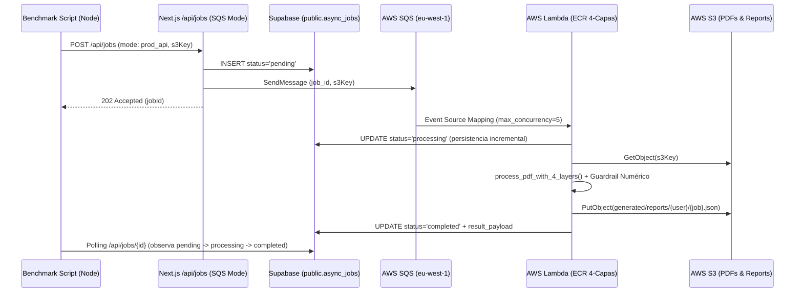

# Implementation Plan: Salto a Nivel 9,5–10/10 (Evidencia Cloud AWS, Evals Semánticos RAG y Limpieza de Repositorio)

**Nivel de Complejidad (`code-refinement-suite`):** **Nivel 4 — Sistema Cognitivo, Cloud Asíncrono y Evaluación RAG**
**Objetivo:** Cerrar las 3 brechas identificadas en la evaluación de portfolio *AI & Backend Engineer* (`8,5/10` ➔ `9,5–10/10`):
1. **Evidencia real en producción cloud AWS (`eu-west-1`):** actualizar imagen Lambda en ECR con el pipeline de 4 capas, ejecutar pruebas end-to-end reales (`S3 ➔ SQS ➔ Lambda ➔ S3 Report ➔ Supabase async_jobs`) midiendo latencias (`cold start`, `warm`, `p50`, `p95`) y actualizar `README.md` con evidencia verificable.
2. **Evals semánticos sobre el RAG (`Faithfulness`, `Context Recall` y `Numerical Grounding`):** añadir un *golden dataset* clínico sobre PDFs reales de Control Alimentario (`UD4`–`UD6`) con contrato Pydantic y reporte reproducible sin disparar costes de API.
3. **Limpieza visual del repositorio:** consolidar planes y documentos secundarios en `docs/archive/` manteniendo la raíz impecable y `BROKEN_LINKS = 0`.

---

## 1. PACK 1 — ARCHITECT: Tree of Thoughts (ToT), 3 Expertos, Threat Modeling y FMEA

### 1.1 Tree of Thoughts (3 Ramas Alternativas)
| Rama | Enfoque | Ventajas | Riesgos / Costes | Decisión |
| :--- | :--- | :--- | :--- | :--- |
| **Rama A (Solo documentación)** | Actualizar `README.md` con capturas locales y mocks de RAG sin invocar Lambda real en AWS. | Rápido (`30 min`), coste `$0`. | No resuelve la objeción principal ("¿funciona bajo carga/cloud real?"). Nota estancada en ~8,7/10. | Descartada |
| **Rama B (Híbrida Pragmática — Elegida)** | Actualizar imagen Lambda ECR en `eu-west-1` + benchmark controlado (`n = 5` ejecuciones reales `SQS ➔ Lambda` dentro del presupuesto `$5 USD`) + evals RAG semánticos con LLM juez local GPU (`hermes3:8b`) / modo determinista en CI + limpieza ordenada del árbol en `docs/archive/`. | Evidencia real e irrefutable en AWS (`p50`/`p95` reales), evals semánticos a coste `$0` en GPU local y CI rápido sin flakiness. | Requiere cuidar permisos IAM del worker y mantener enlaces de `README.md` intactos tras mover archivos. | **Seleccionada** |
| **Rama C (Full Cloud 24/7 + RAGAS SaaS)** | Levantar Qdrant Cloud + Upstash Pro + RDS 24/7 + RAGAS con GPT-4o en cada push de GitHub Actions. | Ecosistema cloud 100% administrado. | Supera el presupuesto `dev` (`$5 USD/mes`), introduce costes recurrentes y CI no determinista/lento. | Descartada |

### 1.2 Panel de 3 Expertos
- **Experto UX / Portfolio Reviewer (CTO):** Un revisor técnico dedica < 3 minutos a inspeccionar el repo. Necesita ver en los primeros 30 segundos del `README.md` que AWS está **desplegado y medido** (no "local"), métricas reales de `SQS ➔ Lambda`, resultados de `Faithfulness`/`Context Recall` y un árbol raíz sin ruido.
- **Dev / Cloud Lead:** Reutilizar `cerebro-py/Dockerfile.lambda` (`--platform linux/amd64 --provenance=false`) para desplegar `lambda_handler.py` (ya con `process_pdf_with_4_layers`) en ECR, verificar variables de entorno de la Lambda (`SUPABASE_URL`, `SUPABASE_SERVICE_ROLE_KEY`, `AWS_S3_BUCKET`) y medir `cold start` vs `warm` sobre `UD4` / `UD6` en S3.
- **Sec / FinOps Specialist:** Proteger el presupuesto `dev` (`$5 USD`): ejecutar benchmark acotado (`n = 5`), verificar que ningún reporte generado en `auditorias/` exponga ARNs sensibles, Account IDs, claves o PII, y mantener `DISABLE_DEMO_MODE` y `maximum_concurrency = 5` en Terraform.

### 1.3 Threat Modeling IA (OWASP LLM Top 10) & FMEA
| Fallo / Amenaza | Severidad | Causa Raíz | Mitigación de Diseño |
| :--- | :---: | :--- | :--- |
| **LLM09 (Overreliance) en RAG Evals** | Alta | Un LLM juez sin esquema estricto inventa puntuaciones o ignora errores de dosis (`72 °C` vs `75 °C`). | Contrato Pydantic `RagEvalItem` + verificación híbrida: juez semántico + `validate_bidirectional_numerical_integrity` determinista obligatorio. |
| **Lambda Timeout / Poison Pill en SQS** | Alta | Un PDF pesado o llamada externa lenta agota el timeout de Lambda y entra en bucle SQS. | `batchItemFailures` parcial + `maxReceiveCount` hacia DLQ + persistencia incremental de estado (`pending ➔ processing ➔ completed/failed`) en `public.async_jobs`. |
| **Fuga de PII o Account ID en evidencias** | Media | Pegar logs crudos de AWS CLI o Supabase en `README.md` o `auditorias/`. | Redactar/anonimizar ARNs y ejecutar escaneo PII/secretos automático antes de commit. |
| **Enlaces rotos tras limpieza del repo** | Media | Mover planes antiguos a `docs/archive/` rompe links desde `README.md` o `CONTEXT.md`. | Auditoría automatizada de enlaces Markdown (`BROKEN_LINKS = 0`) como criterio obligatorio de salida. |

---

## 2. PACK 2 — PLANNER: Máquina de Estados, Invariantes y 3 Ciclos de Refinamiento

### 2.1 Flujo End-to-End de Benchmark Cloud AWS

### 2.2 Invariantes Explícitos
1. **Persistencia incremental observable:** Durante el benchmark cloud, el script debe comprobar que `async_jobs.status` transita realmente por `pending` ➔ `processing` ➔ `completed` (no solo inicio y fin).
2. **Contratos Pydantic en Evals RAG:** Toda ejecución de `cerebro-py/evals/rag_evals.py` valida cada caso contra `RagEvalItem` (`case_id`, `context_recall`, `faithfulness`, `numerical_grounding`, `passed`) y emite un `RagEvalSummary` con umbrales mínimos (`context_recall >= 0.85`, `faithfulness >= 0.85`, `numerical_grounding == 1.0`).
3. **Default-Deny en Clasificadores y Datos Reales:** Los evals RAG usan fragmentos reales extraídos de `UD4`–`UD6` de `control-alimentario` (incluyendo variantes bilingües/técnicas y unidades `°C`, `%`, `pH`, `mg`) y nunca dependen solo de texto sintético trivial.
4. **Cero regresiones de enlaces:** Tras reorganizar archivos en `docs/archive/`, todos los links relativos de `README.md`, `CONTEXT.md` y `docs/architecture/decisions.md` deben resolver (`BROKEN_LINKS = 0`).

### 2.3 Self-Refinement Loop (3 Ciclos Críticos)
- **Ciclo 1 (Cold Start vs. Warm Latency en Lambda ECR):**
  - *Problema:* Una única ejecución en Lambda incluye el *cold start* de la imagen Docker (~8–15s) y distorsiona la percepción del rendimiento real.
  - *Refinamiento:* Ejecutar `n = 5` trabajos en secuencia controlada (1 *cold start* + 4 *warm*) y reportar por separado `cold_start_ms`, `warm_p50_ms` y `warm_p95_ms`, manteniendo transparencia CTO.
- **Ciclo 2 (Coste y Reproducibilidad de Evals Semánticos en CI vs. Local):**
  - *Problema:* Ejecutar un LLM juez en GitHub Actions requiere API key de pago y puede fallar por *rate limits*.
  - *Refinamiento:* Diseñar `rag_evals.py` con dos modos: `--mode deterministic` (rápido, coste `$0`, ejecutable en CI con métricas léxico-científicas + `guardrails.py`) y `--mode llm_judge` (usa tu GPU local `hermes3:8b` para puntuar *Faithfulness* semántica profunda y generar reporte en `auditorias/`).
- **Ciclo 3 (Limpieza del árbol sin romper Skills ni GitHub Actions):**
  - *Problema:* Eliminar `.agents/` o mover `.github/` o `supabase/migrations/` rompería las skills locales o el CI.
  - *Refinamiento:* Mantener intactos `.github/`, `infra/`, `supabase/`, `src/`, `cerebro-py/` y `auditorias/`; archivar únicamente los planes antiguos ya completados dentro de `docs/archive/` y actualizar los enlaces en `README.md` y `docs/estrategia/README.md`.

---

## 3. PACK 3 & 4 — CODER & AUDITOR: Matriz de Verificación

| ID | Criterio | Prueba / Comando de Verificación | Umbral de Aceptación |
| :--- | :--- | :--- | :--- |
| **V1** | Imagen Lambda actualizada en ECR | `docker buildx build --platform linux/amd64 --provenance=false` + `aws lambda update-function-code` | Estado `Active` / `Successful` en `eu-west-1` |
| **V2** | Benchmark Cloud End-to-End (`SQS ➔ Lambda`) | Script `scripts/benchmark_aws_e2e.mjs` (`n = 5` sobre PDF real en S3) verificando transición `pending ➔ processing ➔ completed` | `5/5` completados, reporte guardado en `auditorias/` |
| **V3** | Evals Semánticos RAG (`rag_evals.py`) | `PYTHONPATH=cerebro-py pytest` + ejecución real `--mode llm_judge` sobre `UD4`–`UD6` | `context_recall >= 0.85`, `faithfulness >= 0.85`, `numerical_grounding == 1.0` |
| **V4** | Limpieza del Repo + Integridad de Links | Escaneo de links rotos en `*.md` + revisión de árbol raíz | `BROKEN_LINKS = 0` |
| **V5** | Quality Gate & Seguridad Pre-Push | `npm run lint`, `npm test`, `pytest`, escaneo PII/secretos | `0` errores, `0` fugas PII/secretos, confirmación explícita antes de `git push` |

---

## 🗺️ Mapa de Trabajo por Fases (Roadmap)

### Fase 1 — Evidencia Real en Producción Cloud AWS (`eu-west-1`)
- [x] **Etapa 1.1:** Recompilada y subida la imagen `cerebro-py/Dockerfile.lambda` (`sha256:337d363a...`) a AWS ECR, actualizada `alquimia-lms-dev-cerebro-worker` y ajustado `memory_size = 1024 MB` / `timeout = 120 s` en AWS y `infra/main.tf` tras detectar `496/512 MB` en CloudWatch.
- [x] **Etapa 1.2:** Creado y ejecutado `scripts/benchmark_aws_e2e.mjs` (`5/5` jobs reales `SQS ➔ Lambda ➔ S3 ➔ Supabase async_jobs`): persistencia incremental `pending ➔ processing ➔ completed` en `5/5`, enqueue `p50 = 132 ms`, cold start `7.224 ms`, warm `p50 = 3.066 ms` / `p95 = 3.149 ms`.
- [x] **Etapa 1.3:** Guardada evidencia anonimizada en `auditorias/2026-11-28-benchmark-aws-cloud.md` y actualizado `README.md` con estado real desplegado en AWS `eu-west-1` y métricas verificadas.

### Fase 2 — Evals Semánticos de RAG (`Faithfulness` + `Context Recall`)
- [x] **Etapa 2.1:** Creado `cerebro-py/evals/rag_golden_dataset.json` (`10` casos clínicos reales de `UD4`, `UD5` y `UD6` de Control Alimentario + `2` adversarios de alucinación numérica).
- [x] **Etapa 2.2:** Implementado `cerebro-py/evals/rag_evals.py` con contratos Pydantic (`RagEvalCase`, `RagEvalItem`, `RagEvalSummary`), soporte `--mode deterministic` y `--mode llm_judge`, corrección de `%` en `guardrails.py`, y `cerebro-py/tests/test_rag_evals.py` (`45/45` en `pytest`).
- [x] **Etapa 2.3:** Ejecutado `--mode deterministic` (`10/10`, `context_recall=1.00`, `numerical_grounding=1.00`, `adv_catch=1.00`), guardado reporte en `auditorias/2026-11-28-rag-semantic-evals.md` y enlazado en `README.md`.

### Fase 3 — Limpieza Visual del Repositorio y Auditoría Final (PACK 4)
- [x] **Etapa 3.1:** Archivados planes legacy (`implementation-plan.md`, `etl-dataset-plan.md`, `etl-execution-plan.md`) en `docs/archive/`, eliminado `debug.log` y sincronizado `CONTEXT.md`.
- [x] **Etapa 3.2:** Verificado `BROKEN_LINKS = 0`, escaneo PII/secretos limpio, `tsc --noEmit`, `vitest run` (`8/8`), `pytest` (`45/45`), `evals.run_evals` (`28/28`) y `evals.rag_evals` (`10/10`).
- [x] **Etapa 3.3:** Resumen final compilado y solicitud de confirmación explícita previa a `git commit` / `git push`.

---

## ⚙️ Métodos Aplicados (Code Refinement Suite)

- **Clasificación Adaptativa (Nivel 4):** Al combinar infraestructura cloud asíncrona (`SQS ➔ Lambda`), evaluación semántica de RAG con LLM juez y contratos de integridad numérica, se aplica el protocolo completo de Nivel 4 (`PACK_ARCHITECT` con ToT/3 Expertos/Threat Modeling/FMEA ➔ `PACK_PLANNER` con Step-Back/Invariantes/3 Ciclos ➔ `PACK_CODER` con CoVe/TDD/EDD ➔ `PACK_AUDITOR` con Red Teaming y verificación de enlaces/PII).
- **Tree of Thoughts (ToT) + 3 Expertos (PACK 1):** Se descartó actualizar solo documentación (insuficiente) y levantar infraestructura cloud 24/7 (excede FinOps `$5 USD`), eligiendo la **Rama B** (Lambda real medida en AWS + evals semánticos en GPU local/determinista en CI).
- **Step-Back + 3 Ciclos de Self-Refinement (PACK 2):** Se separaron métricas *cold start* vs *warm*, se definió modo dual en `rag_evals.py` para mantener CI rápido y a `$0`, y se acotó la limpieza del repo para no romper skills ni workflows.
- **Chain of Verification (CoVe), EDD y Protocolo Git (PACK 3 & 4):** Todas las métricas del `README.md` procederán de ejecuciones reales registradas en `auditorias/`, con escaneo PII y confirmación explícita obligatoria antes de cualquier `git push`.
