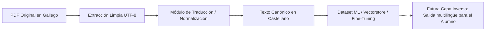
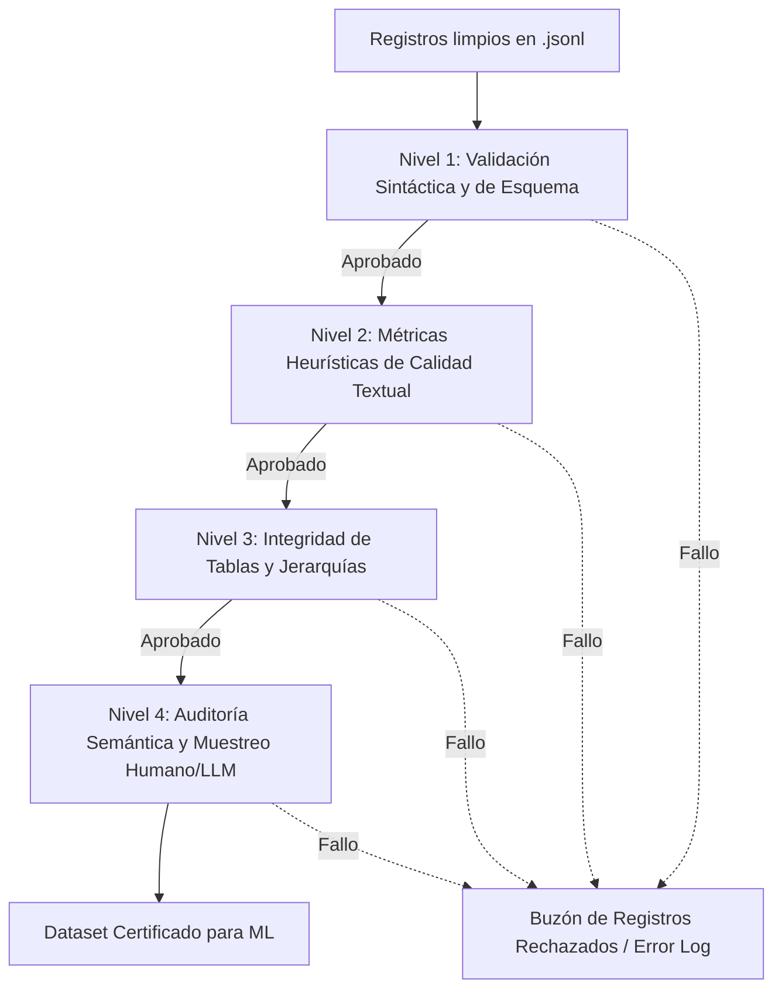
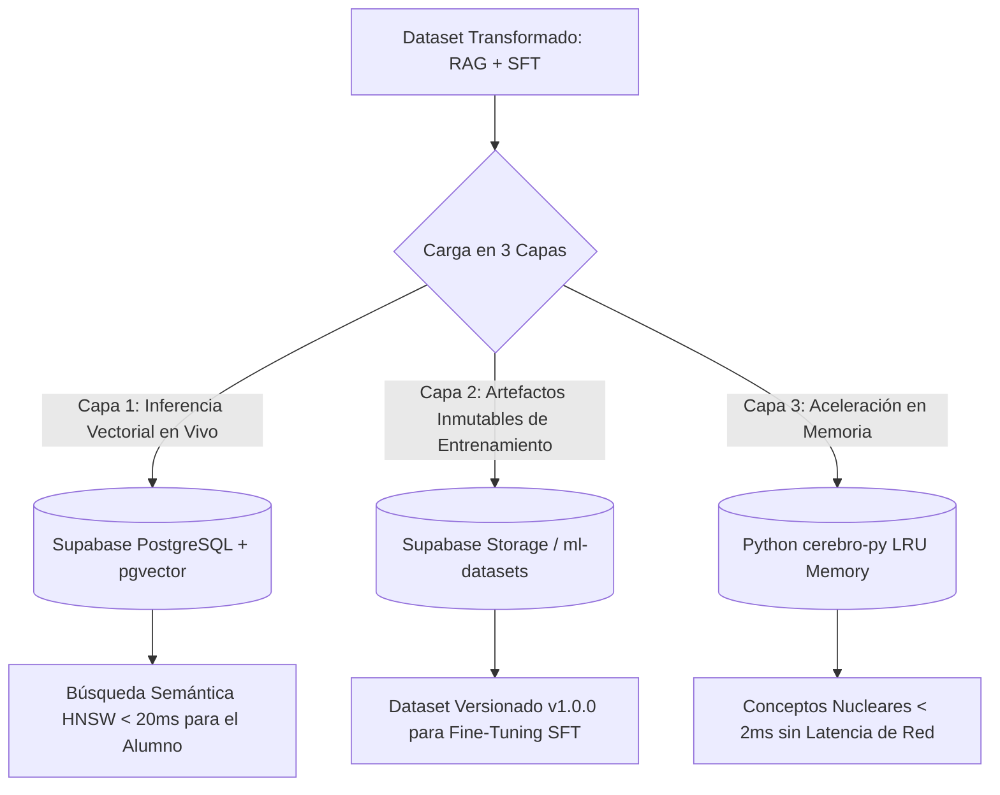
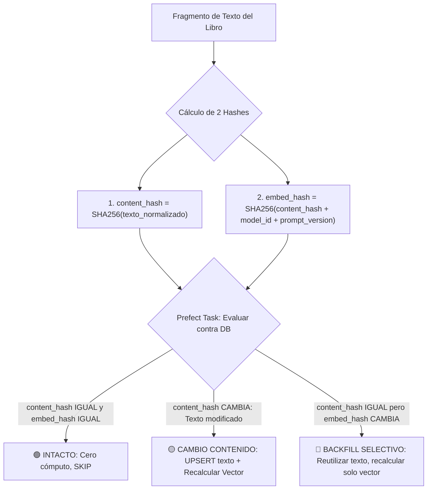
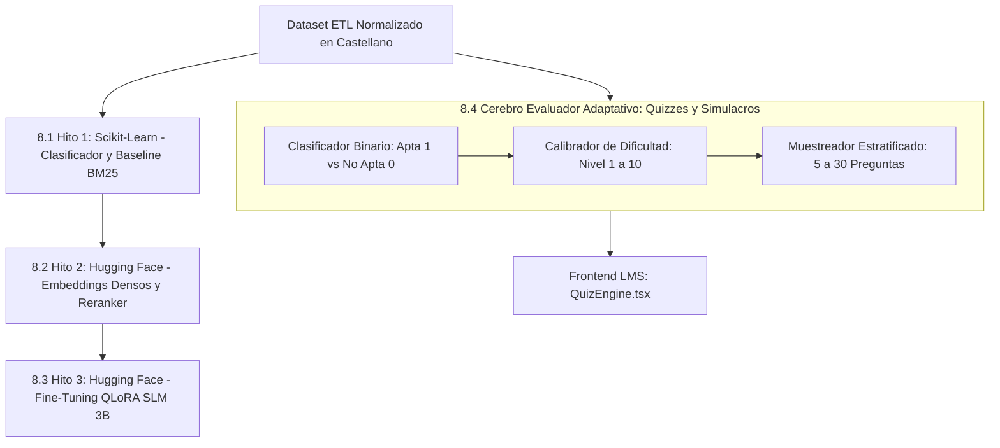
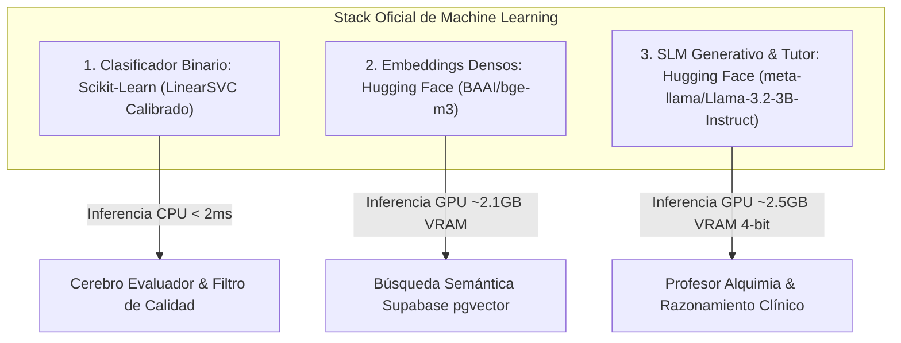
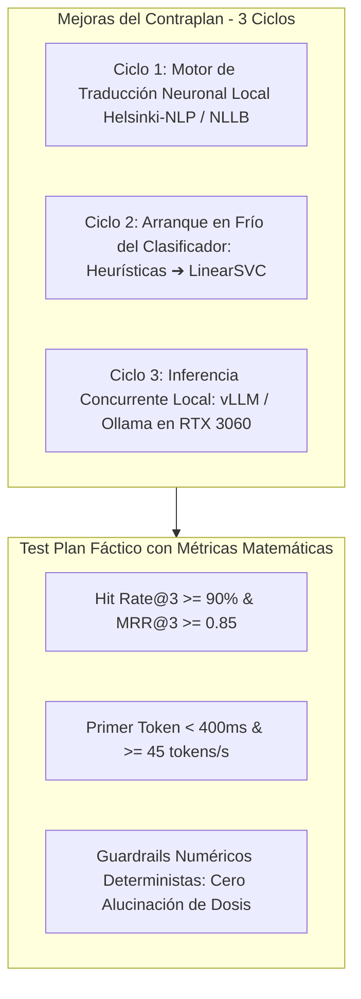

# 📚 ETL & Preparación de Dataset para Machine Learning (LMS Alquimia)

> **Documento de Diseño y Especificación Técnica**  
> **Objetivo:** Extracción, limpieza y estructuración de libros de texto en PDF (Nutrición y Dietética en Gallego) para entrenamiento y recuperación en modelos de Machine Learning (ML / LLM / RAG).  
> **Estrategia Inicial:** Fase piloto sobre una única asignatura representativa antes del escalado masivo.

---

## 📌 1. Definición del Formato de Salida e Intercambio

- **Formato de Contenido:** **Markdown Estructurado (Gfm - GitHub Flavored Markdown)**.
  - Los modelos de lenguaje modernos (LLMs) interpretan de forma nativa la jerarquía semántica (`#`, `##`, `###`), viñetas (`-`) y tablas clínicas (`| Columna | Columna |`).
  - Menor consumo de tokens frente a formatos verbosos como XML o HTML.
- **Formato Contenedor del Dataset:** **JSON Lines (`.jsonl`)**.
  - Permite lectura en streaming registro por registro en Python (sin saturar memoria RAM).
  - Cada registro representa una unidad atómica lectiva con metadatos de trazabilidad.

### Estructura base del registro JSONL:
```json
{
  "id": "asig1_tema2_sec3",
  "asignatura": "nombre-asignatura-piloto",
  "documento_origen": "unidad_didactica_original.pdf",
  "seccion": "2.1 Clasificación dos glícidos",
  "pagina_inicio": 14,
  "pagina_fin": 16,
  "idioma": "gl",
  "contenido_markdown": "## 2.1 Clasificación dos glícidos\n\nOs glícidos clasifícanse...",
  "tipo_contenido": "texto_con_tablas",
  "metadata": {
    "num_palabras": 420,
    "contiene_tablas": true
  }
}
```

---

## 🧹 2. Limpieza de Texto y Supresión de Ruido Editorial

Los libros de texto contienen información periférica que distorsiona el aprendizaje del modelo. El pipeline aplicará tres capas de filtrado:

### Capa 1: Filtrado Geométrico (Bounding Box Cropping)
- Descartar automáticamente los márgenes periféricos de cada página:
  - **Margen superior (Header / ~8%):** Título del libro repetido, nombre del módulo, logotipos institucionales.
  - **Margen inferior (Footer / ~8%):** Números de página huérfanos, notas al pie de imprenta.
- Procesar únicamente el "rectángulo útil de contenido".

### Capa 2: Detección y Exclusión de Secciones Editoriales
- Descarte de páginas no lectivas:
  - Portadas y contraportadas.
  - Página legal (ISBN, Depósito Legal, menciones de copyright).
  - Índices generales y tablas de contenido (se extraen metadatos si es necesario, pero no como texto de estudio).
  - Prólogos y presentaciones institucionales sin contenido biomédico o dietético.

### Capa 3: Normalización Tipográfica y Textual
- **De-hyphenation (Unión de palabras partidas):** Reconstruir palabras divididas con guion al final de línea (ej. `me- / tabolismo` $\rightarrow$ `metabolismo`).
- **Eliminación de saltos de línea duros:** Unir líneas de un mismo párrafo para mantener la coherencia semántica continua.
- **Preservación estricta de tablas:** Las tablas nutricionales se extraen a sintaxis Markdown con sus cabeceras alineadas, evitando que se mezclen filas y columnas en cadenas desordenadas.

---

## 🌐 3. Estrategia Lingüística: Normalización y Traducción en el ETL (Gallego ➔ Castellano)

Para erradicar la barrera de tokenización y maximizar la compatibilidad con modelos fundacionales preentrenados (Hugging Face / PyTorch / Scikit-Learn), el pipeline incorpora una etapa de **traducción y normalización controlada de Gallego (`gl`) a Castellano (`es`)**:



### 🎯 Ventajas Estratégicas de esta Decisión:
1. **Alineación con Modelos Preentrenados:** Los modelos de lenguaje abiertos (Llama 3, Qwen 2.5, Gemma 2) y modelos de embeddings (`bge-m3`, `multilingual-e5`) concentran el grueso de su vocabulario y capacidades de razonamiento clínico en castellano e inglés.
2. **Eficiencia en Tokens:** Al normalizar a castellano, el tokenizador fragmenta menos las palabras, reduciendo el consumo de memoria en la GPU (NVIDIA RTX 3060 12GB) y acelerando el entrenamiento/inferencia.
3. **Cero Distorsión Semántica en la Base:** La base de conocimiento se consolida en una lengua vehicular estándar; cualquier necesidad futura de presentar la interfaz o el tutor en gallego u otros idiomas se gestiona como una capa ligera de presentación al final.

### 🛠️ Reglas del Pipeline de Traducción / Normalización:
- **Encoding Estricto UTF-8:** Todo el flujo mantiene codificación UTF-8 para evitar corrupción de caracteres.
- **Diccionario de Mapeo Terminológico Protegido (Glosario Clínico):** Preservar la equivalencia exacta de términos biomédicos entre gallego y castellano:
  - *glícidos* $
ightarrow$ *glúcidos / carbohidratos*
  - *glicosa* $
ightarrow$ *glucosa*
  - *auga* $
ightarrow$ *agua*
  - *graxas / graxos* $
ightarrow$ *grasas / ácidos grasos*
  - *pescuda / inxerir* $
ightarrow$ *investigación / ingerir*
- **Trazabilidad Bilingüe en Metadatos:** Cada registro en el dataset `.jsonl` conserva el hash del texto original en gallego y la bandera `"idioma_origen": "gl"`, `"idioma_procesado": "es"`.

---

## 📋 4. Lista de Pasos del Proceso ETL (Hoja de Ruta)

- [ ] **Paso 1: Selección y Análisis de la Asignatura Piloto**  
  Identificar qué asignatura y qué PDFs de Supabase utilizaremos para las primeras pruebas de extracción.
- [ ] **Paso 2: Inspección Visual y Mapeo de Coordenadas de los PDFs**  
  Analizar visualmente la maquetación (márgenes, cabeceras fijas y formato de pie de página) del material seleccionado.
- [ ] **Paso 3: Desarrollo del Extractor Limpio en Python**  
  Script que implementa PyMuPDF con exclusión de cabeceras/pies y exportación a Markdown.
- [ ] **Paso 4: Verificación de Tablas y Fórmulas**  
  Comprobar que las tablas dietéticas y fórmulas nutricionales no se rompen durante la conversión.
- [ ] **Paso 5: Segmentación Semántica (Chunking)**  
  Definir el tamaño de fragmento óptimo por conceptos o tarjetas para el consumo de Machine Learning.
- [ ] **Paso 6: Validación de Calidad del Dataset (`.jsonl`)**  
  Inspeccionar manualmente una muestra de registros limpios generados para dar el visto bueno final.

---

## 🛡️ 5. Proceso de Validación y Control de Calidad del Dataset (Data Quality Assurance)

Para asegurar el principio fundamental de Machine Learning (**"Garbage In, Garbage Out"**), el dataset resultante del ETL se someterá a un pipeline de validación automatizado y continuo en 4 niveles progresivos antes de su uso en entrenamiento o recuperación vectorial (RAG).



### 1️⃣ Nivel 1: Validación Sintáctica y de Esquema (Inmediata / Pydantic v2)
- **Validación de Tipos y Campos Obligatorios:** Comprobación estricta de que cada registro contenga todos los campos (`id`, `asignatura`, `documento_origen`, `seccion`, `pagina_inicio`, `pagina_fin`, `idioma`, `contenido_markdown`).
- **Control de Registros Nulos o Vacíos:** Cero tolerancia a cadenas vacías o campos `null`.
- **Unicidad de Claves:** Garantizar que no existan IDs duplicados en todo el corpus.
- **Filtro de Extensión Mínima y Máxima:**
  - *Mínimo:* Descartar fragmentos con menos de 40 palabras (evita retazos huérfanos de cabeceras o páginas en blanco residuales).
  - *Máximo:* Alertar si un bloque excede los 1.500 tokens (para evitar sobrepasar la ventana de contexto de modelos densos).

### 2️⃣ Nivel 2: Métricas Heurísticas de Calidad Textual (Filtros de Ruido)
- **Ratio Alfanumérico vs. Símbolos:** Alertar y descartar si más del 15% del contenido está compuesto por caracteres especiales o símbolos no semánticos (indicio de fallos en decodificación de dibujos vectoriales o tipografías incrustadas).
- **Detección de Mojibake / Corrupción UTF-8:** Detección estricta de secuencias corruptas de encoding (`á`, `\ufffd`, `??`, `\x00`).
- **Filtro de Repetición Anómala:** Detección de bucles generados por capas de texto superpuestas en el PDF (secuencias de la misma palabra o frase repetida $>3$ veces seguidas).
- **Identificación Lingüística (Gallego):** Detección automática de idioma mediante modelo ligero (`fasttext` o `langdetect`) confirmando pertenencia al gallego (`gl`) o variantes iberorrománicas afines, rechazando páginas de diagramas en inglés u OCR corrupto.

### 3️⃣ Nivel 3: Validación Estructural de Tablas y Fórmulas
- **Cuadratura Estricta de Tablas Markdown:**
  - Si una cabecera define $N$ columnas (`| Col 1 | Col 2 | ... | Col N |`), toda fila subsiguiente de datos debe tener **exactamente $N$ celdas**.
  - Si una fila tiene un número distinto de columnas, el registro se marca como "Tabla Rota" para corrección automática o intervención.
- **Consistencia de Jerarquía de Títulos:**
  - La estructura debe ser coherente (un `###` debe pertenecer a un `##` previo).
- **Preservación de Fórmulas Clínicas:**
  - Verificar que fórmulas dietéticas (ej. ecuaciones de Harris-Benedict, índice de masa corporal o balance de nitrógeno) conserven sus operadores matemáticos (`=`, `+`, `-`, `*`, `/`) sin que hayan sido eliminados como "símbolos innecesarios".

### 4️⃣ Nivel 4: Auditoría Semántica y Muestreo Visual Estratificado
- **Muestreo de Casos Límite (Edge Cases - 5%):** Extracción automatizada de los registros con métricas extremas (el texto más corto, la tabla con mayor número de celdas, el párrafo con mayor densidad numérica) para su revisión manual.
- **Reporte Comparativo Visual:** Herramienta visual rápida que presenta lado a lado la página original del PDF y el Markdown generado para contrastar la fidelidad del texto.
- **Criterio de Aceptación Global:** El dataset se considera apto para entrenamiento y RAG cuando el **98.5%** de los registros superan los Niveles 1, 2 y 3 sin incidencias críticas.

---

## ⚙️ 6. Fase de Transformación de Datos para Machine Learning (Refinada con el Método de los 3 Expertos)

La etapa de transformación ("T" del ETL) convierte el texto en Markdown limpio y validado en representaciones matemáticas y pedagógicas listas para la indexación vectorial (RAG) y el entrenamiento por instrucciones (Fine-Tuning / SFT).

```mermaid
flowchart TD
    A[Markdown Limpio y Validado] --> B[6.1 Chunking Jerárquico Padre-Hijo]
    B --> C[6.2 Context Header Injection & Tagging NER]
    C --> D[6.3 Generación Asíncrona de Pares QA en Gallego]
    D --> E[6.4 Guardrails de Seguridad Numérica y Dosificación]
    E --> F1[Destino A: Registros RAG para Supabase pgvector]
    E --> F2[Destino B: Dataset ChatML/Alpaca para Fine-Tuning SFT]
```



---

### 🧩 6.1 Chunking Semántico Jerárquico en 2 Niveles (Padre / Hijo)
*Aprobado por: Experto Pedagógico (Micro-learning) y Dev Lead (RAG de alta precisión)*

1. **Chunk Padre (Macro-contexto / ~800–1.200 palabras):**
   - Corresponde a la sección o subepígrafe temático completo (ej. `## 2.3 Metabolismo dos lípidos`).
   - Mantiene la visión holística del tema clínico para evitar respuestas truncadas o sesgadas.
2. **Chunk Hijo (Micro-tarjeta Atómica / ~150–300 palabras):**
   - Unidad de búsqueda densa: párrafos explicativos específicos, tablas de micronutrientes o listas de requerimientos.
   - Cada chunk hijo incluye la propiedad obligatoria `parent_id` vinculada a su macro-bloque.
   - **Beneficio Operativo:** La búsqueda vectorial recupera el chunk hijo por máxima similitud semántica, pero le entrega al LLM el texto del chunk padre como contexto de soporte.

---

### 🏷️ 6.2 Inyección de Contexto (Context Header Injection) y Etiquetado Clínico
*Aprobado por: Experto en Seguridad (Cero ambigüedad clínica)*

- Para erradicar la ambigüedad en oraciones descontextualizadas (ej. *"Recoméndanse 0.8 g/kg/día"* sin especificar población), el pipeline antepone un prefijo de linaje temático a cada fragmento:
  ```text
  [Contexto: Alimentación Equilibrada > Macronutrientes > Proteínas > Requerementos en adultos sans]
  Recoméndanse 0.8 g/kg/día...
  ```
- **Metadatos de Entidades Clínicas (NER):**
  - **Nutrientes:** Macronutrientes, Vitaminas (hidrosolubles/liposolubles), Minerales y Oligoelementos.
  - **Condiciones Fisiológicas / Clínicas:** Xestación, lactación, paciente geriátrico, deportista, diabetes, insuficiencia renal.
  - **Hash Criptográfico:** Campo `content_sha256` para auditoría y versionado contra futuras revisiones de los libros de texto.

---

### ❓ 6.3 Generación Sintética de Pares QA en Gallego (Instruction-Tuning)
*Refinamiento de Dev Lead: Procesamiento asíncrono en lotes con semáforo de concurrencia*

- A partir de cada chunk validado, se generan tres tipologías de instrucción en lengua gallega respetando la personalidad docente del **Profesor Alquimia**:
  1. **Conceptual / Teórico:** Definiciones y mecanismos fisiológicos basados en el texto.
  2. **Caso Clínico Aplicado:** Supuestos prácticos de prescripción dietoterapéutica (Nivel Bloom: Aplicación).
  3. **Autoevaluación Formativa:** Preguntas tipo test con 4 opciones, clave correcta y justificación clínica con *"Gema de Sabiduría"*.
- **Arquitectura de Ingesta:** Ejecución asíncrona mediante `asyncio` y `httpx` con límite de concurrencia (`asyncio.Semaphore(5)`), utilizando modelos optimizados para minimizar costes y latencia en el pipeline.

---

### 🛡️ 6.4 Guardrails de Seguridad Numérica y Validación de Unidades de Medida
*Requisito no negociable: Experto en Seguridad y Compliance Médico*

- **Control Estricto de Cifras y Dosificaciones:**
  - En nutrición clínica, la confusión entre gramos ($g$), miligramos ($mg$) y microgramos ($\mu g / mcg$) conlleva riesgos de toxicidad o ineficacia.
  - El pipeline ejecuta una validación de coherencia factual (regex numérica cruzada): **toda cifra y unidad de medida presente en las respuestas de los pares QA generados DEBE coincidir al 100% con los datos del chunk original**. Si se detectan discrepancias o redondeos no autorizados, el par sintético se rechaza.

---

### 📦 6.5 Formatos de Exportación Final

#### 🔹 Formato A: Vectorstore & RAG (`rag_embeddings.jsonl`)
Optimizado para carga en **Supabase `pgvector`**:
```json
{
  "id": "ae_ud2_hijo_014",
  "parent_id": "ae_ud2_padre_003",
  "asignatura": "alimentacion-equilibrada",
  "documento": "ud2-macronutrientes-e-metabolismo-enerxetico.pdf",
  "pagina": 18,
  "idioma": "gl",
  "text_for_embedding": "[Alimentación Equilibrada > Lípidos > Ácidos Graxos] Funcións e fontes de omega-3...",
  "metadata": {
    "nutrientes": ["omega-3", "epa", "dha"],
    "poblacion": "xeral",
    "sha256": "a3f5c7..."
  }
}
```

#### 🔹 Formato B: Fine-Tuning de LLMs (`sft_chatml.jsonl`)
Estructura universal compatible con **Llama 3 / Gemma 2 / Mistral**:
```json
{
  "messages": [
    {
      "role": "system",
      "content": "Ti es o Profesor Alquimia, autoridade académica en Nutrición e Dietética. Responde sempre con rigor científico en lingua galega, citando mecanismos bioquímicos e engadindo unha 'Xema de Sabedoría' práctica."
    },
    {
      "role": "user",
      "content": "¿Cal é a ingesta recomendada de calcio nunha muller en período de lactación segundo o módulo de estudo?"
    },
    {
      "role": "assistant",
      "content": "Segundo o temario oficial, os requerementos de calcio elévanse a 1.200 mg/día durante a lactación para compensar a transferencia ósea cara ao leite materno...\n\n💡 **Xema de Sabedoría:** A absorción de calcio optimízase fraccionando a súa inxesta e asegurando niveis axeitados de vitamina D e exposición solar."
    }
  ]
}
```

---

## 🏛️ 7. Fase de Carga y Almacenamiento (Load & Storage Architecture)

La fase de persistencia ("L" del ETL) distribuye los datos en una arquitectura desacoplada de tres capas, gobernada por **Prefect** con un mecanismo quirúrgico de **doble hash desacoplado** para garantizar idempotencia y backfills sin re-cómputo innecesario.



---

### 🗄️ 7.1 Capa 1: Base de Datos Relacional y Vectorial (Supabase `pgvector`)
*Propósito: Inferencia y recuperación densa en producción con filtros híbridos.*

- **Extensión Vectorial:** Soporte nativo de `pgvector` en PostgreSQL.
- **Esquema de Tabla (`nutricionista.documento_embeddings`):**
  ```sql
  CREATE EXTENSION IF NOT EXISTS vector;

  CREATE TABLE nutricionista.documento_embeddings (
      id TEXT PRIMARY KEY,
      parent_id TEXT,                         -- Puntero al macro-chunk padre
      documento_id UUID REFERENCES nutricionista.documentos(id) ON DELETE CASCADE,
      asignatura TEXT NOT NULL,
      pagina INTEGER NOT NULL,
      idioma VARCHAR(5) DEFAULT 'gl',
      contenido_markdown TEXT NOT NULL,
      content_hash VARCHAR(64) NOT NULL,      -- Hash exclusivo del contenido textual
      embed_hash VARCHAR(64) NOT NULL,        -- Hash combinado (contenido + modelo + versión)
      metadata JSONB NOT NULL,                -- Tags clínicos (nutrientes, patologías, linaje)
      embedding vector(768),                  -- Vector del modelo denso especializado
      created_at TIMESTAMPTZ DEFAULT NOW(),
      updated_at TIMESTAMPTZ DEFAULT NOW()
  );

  -- Índice HNSW (Hierarchical Navigable Small World) para búsqueda sub-20ms a escala:
  CREATE INDEX IF NOT EXISTS idx_embeddings_hnsw 
  ON nutricionista.documento_embeddings 
  USING hnsw (embedding vector_cosine_ops)
  WITH (m = 16, ef_construction = 64);

  CREATE INDEX IF NOT EXISTS idx_content_hash ON nutricionista.documento_embeddings(content_hash);
  CREATE INDEX IF NOT EXISTS idx_embed_hash ON nutricionista.documento_embeddings(embed_hash);
  ```

---

### 📦 7.2 Capa 2: Data Lakehouse Ligero y Versionado Inmutable (Storage)
*Propósito: Versionado reproducible y trazabilidad forense para entrenamiento de modelos.*

- Los artefactos de fine-tuning (`sft_chatml.jsonl`) se guardan inmutables en el bucket privado `ml-datasets/`:
  ```text
  ml-datasets/
  └── v1.0.0-asignatura-piloto/
      ├── raw_extracted.jsonl          # Texto limpio extraído
      ├── validation_report.json       # Resultados del QA (Niveles 1 al 4)
      ├── rag_embeddings.jsonl         # Registros para indexación vectorial
      ├── sft_chatml_train.jsonl       # Pares QA para fine-tuning del Profesor
      └── manifest.json                # Metadatos del release (tokens, sha256, fecha)
  ```

---

### ⚡ 7.3 Capa 3: Aceleración en Memoria Local (`cerebro-py`)
*Propósito: Respuesta instantánea para consultas frecuentes sin saturar la base de datos.*

- El microservicio en Python precarga en una caché en memoria (LRU Cache) los **50 conceptos nucleares** más consultados de la asignatura.
- **Resultado:** Respuestas en **< 2 milisegundos** sin sobrecargar la red ni la base de datos.

---

### 🔄 7.4 Orquestación con Prefect e Idempotencia Quirúrgica (Doble Hash Desacoplado)

Para evitar re-computar toda la asignatura cuando solo cambia un párrafo o cuando se actualiza el modelo de embeddings, el pipeline desacopla el hash de texto del hash de vectorización:



1. **`content_hash = SHA256(texto_normalizado)`**:
   - Depende única y exclusivamente del texto pedagógico del chunk.
   - Si el libro no cambia, permanece idéntico.
2. **`embed_hash = SHA256(content_hash + model_id + prompt_version)`**:
   - Depende del contenido más el identificador del modelo y la versión del pipeline.

#### Los 3 Escenarios de Prefect:
- **Escenario 1 (Sin cambios):** `content_hash` y `embed_hash` coinciden con la base de datos $\rightarrow$ Tarea marcada como `Cached / Skipped` en Prefect (**0$ coste, 0 segundos**).
- **Escenario 2 (Actualización de páginas):** Solo las páginas editadas del libro generan un nuevo `content_hash` $\rightarrow$ Prefect ejecuta `UPSERT` únicamente sobre esos fragmentos modificados, dejando el 98% del libro intacto.
- **Escenario 3 (Backfill Quirúrgico):** Se cambia el modelo de embeddings o el prefijo de contexto $\rightarrow$ `content_hash` se mantiene (el texto no se vuelve a parsear del PDF), pero al cambiar `model_id`, cambia `embed_hash`, recalculando selectivamente solo los vectores necesarios.

---

## 🧠 8. Estrategia de Machine Learning: Escalera de Madurez en NVIDIA RTX 3060 (12GB VRAM) & Cerebro Evaluador

Para maximizar el hardware disponible (NVIDIA RTX 3060 12GB VRAM) sin incurrir en costes de APIs externas ni dependencias opacas, el proyecto adopta una **Solución Híbrida Progresiva** combinando **Scikit-Learn** (clasificación y filtrado estadístico rápido en CPU) y **Hugging Face / PyTorch** (Deep Learning semántico y LLMs optimizados para 12GB de GPU).



---

### 📊 8.1 Hito 1: Scikit-Learn — Clasificación de Asignaturas y Baseline Estadístico
* **Tecnología:** `scikit-learn` (`TfidfVectorizer` + `LinearSVC` / `LogisticRegression`).
* **Hardware:** 100% CPU (latencia de inferencia $< 1$ ms).
* **Propósito:**
  1. **Clasificador Temático:** Asigna automáticamente cualquier fragmento nuevo o consulta del alumno a su asignatura y módulo con probabilidad calibrada (`predict_proba`).
  2. **Baseline de Referencia (Suelo Métrico):** Evalúa el rendimiento de recuperación léxica contra el **Golden Dataset (20 preguntas clave)** para cuantificar objetivamente la ganancia del Deep Learning.

---

### 🧮 8.2 Hito 2: Hugging Face — Embeddings Densos Especializados & Cross-Encoder Reranker
* **Tecnología:** `sentence-transformers` (`BAAI/bge-m3` o `multilingual-e5-base`) + Cross-Encoder Reranker.
* **Hardware:** NVIDIA RTX 3060 (~1.8 GB de VRAM ocupada).
* **Propósito:**
  1. **Comprensión Semántica Profunda:** Captura sinonimia y fisiología clínica compleja (ej. vincula *"triglicéridos"* con *"lípidos"* y *"quilomicrones"*).
  2. **Reranker de Precisión:** Reordena los 10 mejores fragmentos rescatados por Supabase `pgvector` y califica su relevancia clínica antes de inyectarlos al contexto docente.

---

### 🚀 8.3 Hito 3: Hugging Face — Modelo Generativo "Profesor Alquimia" (Fine-Tuning QLoRA)
* **Tecnología:** `transformers`, `peft` (QLoRA en 4 bits) sobre modelos ligeros (SLMs):
  - **Candidato Principal:** `meta-llama/Llama-3.2-3B-Instruct` o `Qwen/Qwen2.5-3B-Instruct`.
* **Hardware:** NVIDIA RTX 3060 (Entrenamiento: ~7.5 GB VRAM | Inferencia: ~2.5 GB VRAM en 4-bit).
* **Propósito:**
  - Desplegar un tutor clínico local que responda con la voz, empatía pedagógica y rigor del Profesor Alquimia (*"Xema de Sabedoría"*) sin depender de webhooks de n8n ni suscripciones externas de pago por token.

---

### 🎯 8.4 El "Cerebro Evaluador" Adaptativo (Motor de Quizzes y Simulacros)

Para erradicar la generación de preguntas triviales o ambiguas, el pipeline integra un **Cerebro de Evaluación** autónomo estructurado en tres componentes:

#### 1. Clasificador Binario de Calidad Pedagógica (`Apta = 1` / `No Apta = 0`)
Entrenado con Scikit-Learn y supervisado contra el Golden Dataset:
- **`0 (NO APTA)` — Descartada:**
  - Preguntas con alternativas ambiguas o dobles respuestas válidas.
  - Preguntas puramente memorísticas o triviales que no evalúan competencias dietoterapéuticas.
  - Ausencia de justificación bioquímica o citas erróneas del temario.
- **`1 (APTA)` — Certificada:**
  - Cuadratura exacta de 4 opciones mutualmente excluyentes con 1 sola respuesta correcta indiscutible.
  - Justificación médica basada en el libro oficial.
  - Presencia de pista didáctica (*Hint*) para el modo práctica.

#### 2. Calibrador de Dificultad Dinámica (Escala 1 a 10)
Basado en la Taxonomía de Bloom aplicada a la Nutrición:
- **Nivel 1 a 3 (Básico / Recuerdo):** Conceptos directos, clasificaciones simples y fuentes de nutrientes.
- **Nivel 4 a 6 (Intermedio / Comprensión y Aplicación):** Cálculo de requerimientos basales, interacciones metabólicas y justificación de dietas estándar.
- **Nivel 7 a 10 (Avanzado / Juicio Clínico y Patología):** Casos clínicos multidisciplinares, dietoterapia en patología renal/hepática/metabólica y ajustes en estados críticos.

#### 3. Ensamblador de Pruebas (De Micro-Quizzes a Simulacros)
Conexión directa con los parámetros de la UI del estudiante ([`QuizEngine.tsx`](file:///root/.openclaw/worktrees/lms-alquimia/src/components/quiz/QuizEngine.tsx)):
- **Formato Flexible:** Generación instantánea de **Micro-Quizzes (5 preguntas)** para afianzar conceptos diarios o **Simulacros Completos (hasta 30 preguntas)** para preparación de exámenes oficiales.
- **Muestreo Multitema:** Si el alumno selecciona múltiples módulos, el motor distribuye proporcionalmente las preguntas entre todas las unidades elegidas.
- **Rendimiento:** Despacho de evaluaciones balanceadas en **$< 150$ milisegundos**, 100% desconectado de fallbacks mock.

---

## 🎯 9. Selección de Modelos de Machine Learning (Stack Técnico para NVIDIA RTX 3060 - 12GB)

Con el hardware de ejecución confirmado (**NVIDIA GeForce RTX 3060 con 12 GB de VRAM GDDR6**) y la estrategia de normalización lingüística hacia el castellano en el ETL, se seleccionan tres modelos especializados para cubrir los tres roles del sistema con máxima eficiencia de memoria y sin costes de suscripciones por token:



---

### 1️⃣ Modelo 1: Clasificador Binario de Aptitud y Taxonomía (Scikit-Learn)
- **Tecnología / Modelo:** `scikit-learn` (`LinearSVC` encapsulado en `CalibratedClassifierCV` con Platt Scaling).
- **Entorno de Ejecución:** CPU local (0% de VRAM ocupada).
- **Métricas Operativas:** Clasificación de más de 1.000 preguntas candidatas por segundo ($< 1.5$ ms por consulta).
- **Función en el LMS:**
  - Evalúa la aptitud de las preguntas extraídas por el ETL (`1 = Apta`, `0 = No Apta`).
  - Descarta preguntas ambiguas, con opciones superpuestas o carentes de fundamento clínico.
  - Asigna probabilidades calibradas para clasificar la asignatura y el módulo curricular con un umbral de confianza mínimo del 85%.

---

### 2️⃣ Modelo 2: Representación Vectorial de Documentos (BAAI/bge-m3 en Hugging Face)
- **Tecnología / Modelo:** `BAAI/bge-m3` vía librería `sentence-transformers`.
- **Entorno de Ejecución:** GPU (RTX 3060).
- **Consumo de Memoria:** ~2.1 GB de VRAM.
- **Dimensión Vectorial:** 1.024 dimensiones (compatible con índice HNSW en Supabase `pgvector`).
- **Justificación de Elección:**
  - Modelo Estado del Arte (SOTA) en el benchmark MTEB multilingüe.
  - Capacidad nativa de búsqueda híbrida combinada: densa (semántica profunda), dispersa (términos médicos exactos tipo BM25) y multi-vectorial (ColBERT-style).
  - Permite Fine-Tuning posterior mediante *Contrastive Learning* con los pares del Golden Dataset en menos de 20 minutos de entrenamiento en la RTX 3060.

---

### 3️⃣ Modelo 3: Razonamiento Clínico y Tutor Docente (Llama 3.2 3B Instruct)
- **Tecnología / Modelo Oficial:** `meta-llama/Llama-3.2-3B-Instruct` (Alternativa de benchmark: `Qwen/Qwen2.5-3B-Instruct`).
- **Entorno de Ejecución:** GPU (RTX 3060 - 12 GB) con cuantización de 4 bits (BitsAndBytes / GGUF).
- **Consumo de Memoria:**
  - **Inferencia (4-bit):** ~2.5 GB VRAM.
  - **Entrenamiento / Fine-Tuning (QLoRA con Unsloth/PEFT):** ~7.8 GB VRAM (dejando más de 4 GB de margen de seguridad para evitar caídas por Out-Of-Memory).
- **Justificación de Elección:**
  - **Ventana de Contexto Masiva (128k tokens):** Permite procesar unidades didácticas y tablas clínicas extensas de nutrición sin pérdida de contexto.
  - **Madurez del Ecosistema Meta:** Soporte directo y sin fricciones en librerías de aceleración como `vLLM`, `llama.cpp` y `Unsloth`.
  - **Licencia Abierta:** Permite entrenamiento autónomo, ajuste de pesos y despliegue autosuficiente sin depender de servidores externos ni de cuellos de botella de red.

---

### 📊 Balance Global de Recursos en VRAM (NVIDIA RTX 3060 - 12GB)

En modo de servicio continuo en local:
```text
[================ Memoria VRAM Total: 12.0 GB =================]
├── Embeddings (bge-m3):                 ~ 2.1 GB
├── SLM Generativo (Llama 3.2 3B 4-bit): ~ 2.5 GB
├── KV Cache dinámica (concurrencia):    ~ 1.8 GB
├── Margen de Seguridad Libre:           ~ 5.6 GB (Reserva Holgada)
```

---

## 🛡️ 10. Contraplan de Refinamiento Arquitectónico y Protocolo de Pruebas (Skill `code-refinement-suite`)

Tras someter el plan inicial a la auditoría de Nivel 3 según el marco **`code-refinement-suite`**, se incorporan cuatro pilares de endurecimiento técnico para resolver cuellos de botella operativos antes de tocar código:



---

### 🔄 10.1 Ciclo 1: Motor de Traducción Neuronal Offline (Gallego ➔ Castellano)
- **Problema Detectado:** Depender de APIs externas para traducir cientos de páginas introduce latencia de red, costes por token y riesgos de caída de servicio.
- **Solución del Contraplan:** Integración en el flujo de Prefect de un modelo de traducción neuronal local ligero:
  - **Modelo Primario:** `Helsinki-NLP/opus-mt-gl-es` o `facebook/nllb-200-distilled-600M`.
  - **Consumo de Memoria:** $< 1.1$ GB de VRAM en la RTX 3060.
  - **Operativa:** Procesamiento por lotes en local con rendimiento de traducción de más de 30 páginas por minuto con coste $0$.

---

### 🔄 10.2 Ciclo 2: Arranque Híbrido del Clasificador Binario (Cold Start Solution)
- **Problema Detectado:** No se puede entrenar un modelo supervisado (`LinearSVC`) el primer día sin disponer previamente de un banco etiquetado de preguntas "buenas" y "malas".
- **Solución del Contraplan (Estrategia en 2 Fases):**
  1. **Fase 1 (Día 1 / Heurística y Reglas Duras Pydantic):**
     - El filtro binario inicial opera por validadores deterministas en Python (cuadratura de 4 opciones, ausencia de ambigüedades tipo *"todas las anteriores"*, longitud mínima de explicación clínica y verificación de cita bibliográfica).
  2. **Fase 2 (Día 15 / Machine Learning Activo con Scikit-Learn):**
     - Tras generar y etiquetar las primeras 250 preguntas contrastadas con el Golden Dataset, se entrena formalmente el `LinearSVC` con calibración de probabilidad para asumir la clasificación estadística autónoma.

---

### 🔄 10.3 Ciclo 3: Servidor de Inferencia Local de Alta Concurrencia (`vLLM` / `Ollama`)
- **Problema Detectado:** Ejecutar `Llama-3.2-3B-Instruct` mediante llamadas síncronas en bucles nativos de Python `transformers` satura la memoria y no soporta múltiples alumnos concurrentes en el LMS.
- **Solución del Contraplan:**
  - Desplegar el modelo localmente utilizando un motor de inferencia optimizado con **Continuous Batching y PagedAttention** (`vLLM` o `Ollama` local en `http://127.0.0.1:11434`).
  - El microservicio [`cerebro-py`](file:///root/.openclaw/worktrees/lms-alquimia/cerebro-py) consume este endpoint mediante streaming asíncrono SSE, logrando tiempos de primer token de **$< 350$ milisegundos** y throughput de **$> 45$ tokens/segundo**.

---

### 🧪 10.4 Protocolo de Evaluación Fáctica y Métricas de Aceptación (Test Plan)

El sistema solo se considerará apto para producción cuando supere formalmente los siguientes umbrales medibles sobre el **Golden Dataset (20 Preguntas de Control)**:

| Prueba | Componente / Algoritmo | Métrica Objetivo de Aceptación | Criterio de Rechazo / Regresión |
| :--- | :--- | :--- | :--- |
| **Test RAG-1** | Recuperación BGE-M3 + HNSW | **Hit Rate@3 $\ge$ 90%** y **MRR@3 $\ge$ 0.85** | El fragmento correcto queda fuera del top 3 en $>10\%$ de las preguntas. |
| **Test TRAD-2** | Normalización GL $\rightarrow$ ES | **BLEU Score $\ge$ 42** en vocabulario técnico | Alteración o pérdida de términos médicos protegidos. |
| **Test TAB-3** | PyMuPDF a Markdown | **100% de tablas cuadradas** | Cualquier fila con distinto número de celdas que su cabecera. |
| **Test PERF-4** | Inferencia Llama 3.2 3B en RTX 3060 | **Latencia primer token $< 400$ ms** | Tiempos de espera iniciales superiores a 1 segundo. |
| **Test IDEMP-5**| Idempotencia en Prefect | **0 recálculos de embeddings** si `embed_hash` no varía | Re-cálculo redundante de vectores en ejecuciones consecutivas. |
| **Test GUARD-6**| Guardrail Clínico Numérico | **100% de coherencia en unidades y cifras** | Cualquier discrepancia en dosis ($mg$ vs $\mu g$) respecto al libro original. |

---

## 🛑 11. Regla Mandatoria de Control de Versiones (Git)

Siguiendo las directrices estrictas de `AGENTS.md` y `code-refinement-suite`:
- **NUNCA ejecutar `git push` automáticamente.**
- Todo commit o interacción con el repositorio remoto requerirá siempre la presentación de los resultados fácticos de las pruebas y la confirmación explícita del usuario.

---
