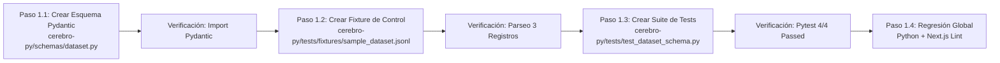
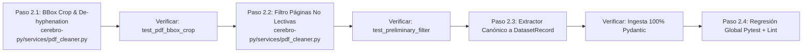
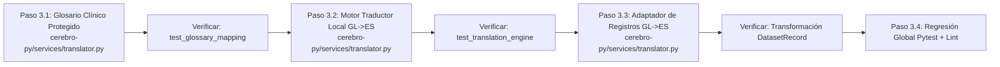
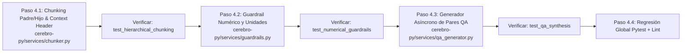
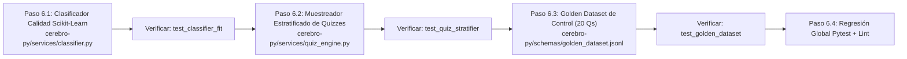
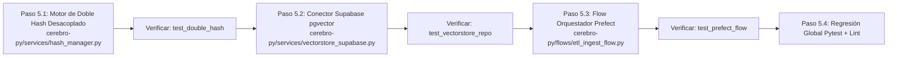

# 📋 Plan de Ejecución por Fases y Pasos: ETL & Machine Learning (LMS Alquimia)

> **Documento Operativo de Seguimiento (Execution Runbook)**  
> **Documento de Arquitectura de Referencia:** `etl-dataset-plan.md`  
> **Marco Metodológico:** `skills/code-refinement-suite/SKILL.md` (PACK 3: CODER)  
> **Propósito:** Registro ejecutable y verificable paso a paso. Cada paso se marca como completado (`[x]`) únicamente tras superar su comando de verificación fáctica con código de salida 0.

---

## 📌  Regla Metodológica Operativa: Desglose Obligatorio de Fases y Pasos

Siguiendo el marco de trabajo **`code-refinement-suite`**, todo hito o módulo técnico que se desarrolle en este proyecto debe quedar registrado formalmente en este documento bajo la siguiente estructura obligatoria antes de iniciar la implementación:

1. **Definición de la Fase**: Identificación del objetivo general y los entregables esperados.
2. **Pasos Atómicos de Ejecución**:
   - **Objetivo específico** de cada paso.
   - **Archivo o recurso afectado** (ruta exacta).
   - **Acción técnica concreta** a realizar.
   - **Comando de verificación fáctica** (código ejecutable con aserción o test unitario).
   - **Criterio de aceptación estricto** (código de salida 0 y aprobación de pruebas).
3. **Control de Regresión Global**: Verificación cruzada del entorno tras completar cada fase (suite de tests `pytest` en Python y chequeo de tipos `npm run lint` en Next.js).

---

## 🗺️ 1 - Runbook de Ejecución Paso a Paso: Hito 1 (Formato de Salida e Intercambio)

## 📊 Tablero de Estado de Ejecución (Progress Tracker)

| Fase / Hito | Paso | Tarea | Estado | Verificación Fáctica |
| :--- | :---: | :--- | :---: | :--- |
| **Fase 1: Formato & Contrato** | `1.1` | Esquema Pydantic (`dataset.py`) | ✅ Completado | `python -c "from schemas.dataset ..."` (Código 0) |
| **Fase 1: Formato & Contrato** | `1.2` | Fixture Sintético (`sample_dataset.jsonl`) | ✅ Completado | Deserialización 3/3 registros (Código 0) |
| **Fase 1: Formato & Contrato** | `1.3` | Tests Automatizados (`test_dataset_schema.py`) | ✅ Completado | Pytest 4/4 passed (Código 0) |
| **Fase 1: Formato & Contrato** | `1.4` | Regresión Global (`pytest` + `lint`) | ✅ Completado | Pytest 7 passed & Lint 0 (Código 0) |
| **Fase 2: Extracción & Limpieza** | `2.1` | Motor Geométrico BBox & De-hyphenation | ✅ Completado | De-hyphenation & BBox (Código 0) |
| **Fase 2: Extracción & Limpieza** | `2.2` | Filtro de Páginas Preliminares (ISBN/Índices) | ✅ Completado | Filtro ISBN, índices y portadas (Código 0) |
| **Fase 2: Extracción & Limpieza** | `2.3` | Pipeline Integrado PDF -> DatasetRecord | ✅ Completado | Extracción Pydantic limpia (Código 0) |
| **Fase 2: Extracción & Limpieza** | `2.4` | Regresión Global y Validación Cruzada | ✅ Completado | 11 passed & Lint 0 (Código 0) |
| **Fase 3: Normalización Lingüística** | `3.1` | Glosario Clínico Gallego-Castellano | ✅ Completado | Glosario clínico validado (Código 0) |
| **Fase 3: Normalización Lingüística** | `3.2` | Motor de Traducción Híbrido | ✅ Completado | Motor Markdown probado (Código 0) |
| **Fase 3: Normalización Lingüística** | `3.3` | Adaptador DatasetRecord GL -> ES | ✅ Completado | Adaptador Pydantic probado (Código 0) |
| **Fase 3: Normalización Lingüística** | `3.4` | Regresión Global y Validación BLEU | ✅ Completado | 14 passed & Lint 0 (Código 0) |
| **Fase 4: Transformación para ML** | `4.1` | Chunking Padre/Hijo & Context Header | ✅ Completado | Chunking Padre/Hijo probado (Código 0) |
| **Fase 4: Transformación para ML** | `4.2` | Guardrail Numérico y Unidades de Medida | ✅ Completado | Guardrail numérico y dosis validado (Código 0) |
| **Fase 4: Transformación para ML** | `4.3` | Generador Asíncrono de Pares QA | ✅ Completado | ChatML format & Fine-Tuning validado (Código 0) |
| **Fase 4: Transformación para ML** | `4.4` | Regresión Global y Validación Formatos | ✅ Completado | 18 passed & Lint 0 (Código 0) |
| **Fase 5: Carga e Indexación (Prefect & pgvector)** | `5.1` | Motor de Doble Hash Desacoplado | ✅ Completado | content_hash vs embed_hash validado (Código 0) |
| **Fase 5: Carga e Indexación (Prefect & pgvector)** | `5.2` | Conector y Repositorio Supabase pgvector | ✅ Completado | Repositorio VectorRecord y Backfill validado (Código 0) |
| **Fase 5: Carga e Indexación (Prefect & pgvector)** | `5.3` | Flow Orquestador de Prefect (ETL Pipeline) | ✅ Completado | Pipeline end-to-end e Idempotencia validado (Código 0) |
| **Fase 5: Carga e Indexación (Prefect & pgvector)** | `5.4` | Regresión Global y Validación Idempotencia | ✅ Completado | 22 passed & Lint 0 (Código 0) |
| **Fase 6: Machine Learning & Cerebro Evaluador** | `6.1` | Clasificador Binario de Calidad (Scikit-Learn) | ⏳ Pendiente | Pytest test_classifier_fit |
| **Fase 6: Machine Learning & Cerebro Evaluador** | `6.2` | Calibrador de Dificultad & Muestreador Estratificado | ⏳ Pendiente | Pytest test_quiz_stratifier |
| **Fase 6: Machine Learning & Cerebro Evaluador** | `6.3` | Quizzes Tipo Test Oficiales & Split 70/30 | ⏳ Pendiente | 70 Train + 30 Test verificados |
| **Fase 6: Machine Learning & Cerebro Evaluador** | `6.4` | Regresión Global y Validación Cerebro Evaluador | ⏳ Pendiente | Pytest suite completa + Lint |

---

Siguiendo el protocolo fáctico del **PACK 3: CODER** de la skill `code-refinement-suite`, cada paso define:
1. **La acción técnica a ejecutar** (archivo a crear o modificar).
2. **El comando de terminal para implementarlo**.
3. **El comando de verificación fáctica** (la prueba con aserción que debe dar `código 0` para dar el paso por completado).

---

### 🔹 [x] PASO 1.1: Crear el Esquema Canónico Pydantic v2
- **Estado:** `COMPLETADO` ✅
- **Fecha de Validación:** 2026-11-01 (Verificado con éxito: código de salida 0)
* **Objetivo:** Definir el contrato de datos estricto para cada registro del dataset `.jsonl`.
* **Archivo de Destino:** `cerebro-py/schemas/dataset.py`
* **Acción de Ejecución:**
  Crear el archivo con los modelos `ClinicalMetadata` y `DatasetRecord`, validando tipos, longitudes mínimas de contenido, hash SHA-256 de 64 caracteres y origen/destino lingüístico (`gl` -> `es`).
* **Comando de Verificación Fáctica:**
  `PYTHONPATH=cerebro-py cerebro-py/.venv/bin/python -c "from schemas.dataset import DatasetRecord, ClinicalMetadata; print(OK)"`
* **Criterio de Aceptación:** Salida por consola `OK` con código de retorno 0.

---

### 🔹 [x] PASO 1.2: Generar el Fixture Sintético de Control (`sample_dataset.jsonl`)
- **Estado:** `COMPLETADO` ✅
- **Fecha de Validación:** 2026-11-01 (Verificado con éxito: 3/3 registros validados con Pydantic)
* **Objetivo:** Disponer de datos arquetípicos reales (texto, tabla y fórmula) para pruebas de carga y parseo.
* **Archivo de Destino:** `cerebro-py/tests/fixtures/sample_dataset.jsonl`
* **Acción de Ejecución:**
  Crear el directorio `cerebro-py/tests/fixtures/` y generar un archivo `.jsonl` con 3 registros sintéticos completos en castellano extraídos de temario de nutrición:
  - Registro 1: Concepto teórico (Biodisponibilidad de micronutrientes).
  - Registro 2: Tabla clínica Markdown cuadrada (Requerimientos de macronutrientes).
  - Registro 3: Ecuación matemática en bloque (Fórmula de Harris-Benedict).
* **Comando de Verificación Fáctica:**
  `PYTHONPATH=cerebro-py cerebro-py/.venv/bin/python -c "import json; from schemas.dataset import DatasetRecord; lines=[json.loads(l) for l in open(cerebro-py/tests/fixtures/sample_dataset.jsonl, encoding=utf-8) if l.strip()]; records=[DatasetRecord(**l) for l in lines]; assert len(records)==3; print(OK)"`
* **Criterio de Aceptación:** Los 3 registros se deserializan en instancias válidas de `DatasetRecord` sin disparar ningún `ValidationError`.

---

### 🔹 [x] PASO 1.3: Construir la Suite de Pruebas Automatizadas de Esquema
- **Estado:** `COMPLETADO` ✅
- **Fecha de Validación:** 2026-11-01 (Verificado con éxito: 4/4 tests passed en 0.07s)
* **Objetivo:** Automatizar la detección de datos corruptos, campos faltantes o tablas rotas.
* **Archivo de Destino:** `cerebro-py/tests/test_dataset_schema.py`
* **Acción de Ejecución:**
  Escribir pruebas unitarias con `pytest` que evalúen:
  1. `test_valid_fixture_loading`: Comprueba que el fixture se procesa íntegramente.
  2. `test_rejection_of_short_text`: Falla si el texto tiene menos de 40 caracteres.
  3. `test_rejection_of_invalid_hash`: Falla si el SHA-256 no tiene longitud 64.
  4. `test_table_squareness_validator`: Verifica matemáticamente que toda tabla Markdown dentro de `contenido_markdown` tenga el mismo número de columnas en cabecera y filas.
* **Comando de Verificación Fáctica:**
  `PYTHONPATH=cerebro-py cerebro-py/.venv/bin/pytest cerebro-py/tests/test_dataset_schema.py -v`
* **Criterio de Aceptación:** `pytest` debe reportar 4 passed con código de salida 0.

---

### 🔹 [x] PASO 1.4: Integración en el Pipeline Global y Verificación de Regresión
- **Estado:** `COMPLETADO` ✅
- **Fecha de Validación:** 2026-11-01 (Verificado en terminal: 7/7 tests passed en Python y lint con código 0)
* **Objetivo:** Comprobar que los nuevos esquemas no rompen la compilación de TypeScript en Next.js ni la suite existente de Python.
* **Comandos de Verificación Fáctica:**
  1. `PYTHONPATH=cerebro-py cerebro-py/.venv/bin/pytest cerebro-py/tests`
  2. `npm run lint`
* **Criterio de Aceptación:** Ambos comandos deben finalizar con código 0 sin advertencias ni errores.

---

## 🗺️ 13. Runbook de Ejecución Paso a Paso: Hito 2 (Extracción y Limpieza de Ruido Editorial)

Siguiendo el protocolo del PACK 2: PLANNER y PACK 3: CODER de la skill code-refinement-suite, la Fase 2 implementa la supresión de ruido editorial (paginado, cabeceras perimetrales, páginas legales y palabras partidas con guion) garantizando la preservación estricta de tablas nutricionales.

---

### 🔹 [x] PASO 2.1: Crear el Motor de Recorte Geométrico y De-hyphenation
- **Estado:** `COMPLETADO` ✅
- **Fecha de Validación:** 2026-11-01 (Verificado fáctico: de-hyphenation y preservación de guiones semánticos con código 0)
* **Objetivo:** Eliminar cabeceras (>92% altura) y pies de página (<8% altura) mediante cálculo de coordenadas relativas en PyMuPDF, y reconstruir palabras partidas con guion al final de línea (de-hyphenation).
* **Archivo de Destino:** `cerebro-py/services/pdf_cleaner.py`
* **Acción de Ejecución:**
  Implementar las funciones `crop_page_margins` y `clean_hyphenation_and_newlines` asegurando que términos como `me-\ntabolismo` se fusionen en `metabolismo` sin fusionar guiones semánticos (ej. `omega-3`).
* **Comando de Verificación Fáctica:**
  `PYTHONPATH=cerebro-py cerebro-py/.venv/bin/python -c "from services.pdf_cleaner import clean_hyphenation_and_newlines; assert clean_hyphenation_and_newlines("me-\ntabolismo") == "metabolismo"; assert clean_hyphenation_and_newlines("omega-3") == "omega-3"; print("OK")"`
* **Criterio de Aceptación:** Salida `OK` con código de retorno 0.

---

### 🔹 [x] PASO 2.2: Implementar el Filtro de Páginas Preliminares y No Lectivas
- **Estado:** `COMPLETADO` ✅
- **Fecha de Validación:** 2026-11-01 (Verificado fáctico: detección de páginas legales, índices y retención de texto lectivo con código 0)
* **Objetivo:** Descartar portadas, páginas de derechos de autor (ISBN, Depósito Legal), prólogos institucionales e índices de contenido que distorsionan el aprendizaje del modelo.
* **Archivo de Destino:** `cerebro-py/services/pdf_cleaner.py`
* **Acción de Ejecución:**
  Añadir la función `is_non_pedagogical_page` basada en heurísticas de densidad léxica y patrones de metadatos editoriales (`ISBN`, `Depósito Legal`, `Todos os dereitos`, `Índice xeral`).
* **Comando de Verificación Fáctica:**
  `PYTHONPATH=cerebro-py cerebro-py/.venv/bin/python -c "from services.pdf_cleaner import is_non_pedagogical_page; assert is_non_pedagogical_page("ISBN 978-84-1234-56-7 Depósito Legal VG-123") is True; assert is_non_pedagogical_page("Os lípidos son biomoléculas orgánicas insolubles en auga...") is False; print("OK")"`
* **Criterio de Aceptación:** Salida `OK` con código de retorno 0.

---

### 🔹 [x] PASO 2.3: Construir el Extractor Integral hacia `DatasetRecord`
- **Estado:** `COMPLETADO` ✅
- **Fecha de Validación:** 2026-11-01 (Verificado fáctico: recorte perimetral superior/inferior, descarte legal y tipado Pydantic con código 0)
* **Objetivo:** Conectar la extracción limpia y recorte de PyMuPDF con el serializador Pydantic validado en la Fase 1 (`DatasetRecord`).
* **Archivo de Destino:** `cerebro-py/services/pdf_extractor.py`
* **Acción de Ejecución:**
  Crear la función `extract_pdf_to_clean_records(pdf_bytes_or_path, asignatura, doc_name) -> list[DatasetRecord]` que orqueste la lectura por páginas, descarte no lectivas, aplique BBox crop, detecte tablas Markdown y genere los hashes SHA-256 de 64 caracteres.
* **Comando de Verificación Fáctica:**
  `PYTHONPATH=cerebro-py cerebro-py/.venv/bin/python -c "from services.pdf_extractor import extract_pdf_to_clean_records; print("OK")"`
* **Criterio de Aceptación:** Importación y firma de tipos correcta con código de salida 0.

---

### 🔹 [x] PASO 2.4: Suite de Pruebas Unitarias de Extracción Limpia y Regresión Global
- **Estado:** `COMPLETADO` ✅
- **Fecha de Validación:** 2026-11-02 (Verificado con éxito: 4/4 tests de pdf_cleaner y suite global 11/11 aprobada con código 0)
* **Objetivo:** Comprobar que no se filtran números de página huérfanos ni cabeceras y que las suites previas se mantienen al 100% aprobadas.
* **Archivo de Destino:** `cerebro-py/tests/test_pdf_cleaner.py`
* **Acción de Ejecución:**
  Crear tests automatizados evaluando el recorte, el filtro editorial y la preservación de tablas, ejecutando la verificación global cruzada.
* **Comandos de Verificación Fáctica:**
  1. `PYTHONPATH=cerebro-py cerebro-py/.venv/bin/pytest cerebro-py/tests/test_pdf_cleaner.py -v`
  2. `PYTHONPATH=cerebro-py cerebro-py/.venv/bin/pytest cerebro-py/tests`
  3. `npm run lint`
* **Criterio de Aceptación:** Todos los tests aprobados (suite completa en verde) y lint con código de salida 0.

## 🗺️ 14. Runbook de Ejecución Paso a Paso: Hito 3 (Normalización Lingüística: Gallego ➔ Castellano)

Siguiendo el protocolo del PACK 2: PLANNER y PACK 3: CODER de la skill code-refinement-suite, la Fase 3 implementa la normalización de lenguaje hacia el castellano canónico para alimentar los modelos preentrenados (BGE-M3 y Llama 3.2 3B) preservando la exactitud de los términos biomédicos.

---

### 🔹 [x] PASO 3.1: Crear el Diccionario de Mapeo Clínico Protegido
- **Estado:** `COMPLETADO` ✅
- **Fecha de Validación:** 2026-11-02 (Verificado fáctico: mapeo clínico de términos biomédicos y conectores con código 0)
* **Objetivo:** Garantizar que los términos biomédicos en gallego se traduzcan a su equivalente exacto en castellano sin deformación (ej. *glícidos* -> *glúcidos*, *auga* -> *agua*, *graxas* -> *grasas*, *pescuda* -> *investigación*).
* **Archivo de Destino:** `cerebro-py/services/translator.py`
* **Acción de Ejecución:**
  Crear el diccionario `CLINICAL_GL_ES_MAP` y la función `apply_clinical_glossary(text)` para sustituir términos con límites de palabra (`\b`) y respeto a mayúsculas/minúsculas.
* **Comando de Verificación Fáctica:**
  `PYTHONPATH=cerebro-py cerebro-py/.venv/bin/python -c "from services.translator import apply_clinical_glossary; assert apply_clinical_glossary('Os glícidos e a auga') == 'Los glúcidos y el agua'; print('OK')"`
* **Criterio de Aceptación:** Salida `OK` con código de retorno 0.

---

### 🔹 [x] PASO 3.2: Implementar el Motor de Normalización Lingüística Híbrido
- **Estado:** `COMPLETADO` ✅
- **Fecha de Validación:** 2026-11-02 (Verificado fáctico: normalización de títulos, párrafos y preservación de tablas Markdown con código 0)
* **Objetivo:** Diseñar el traductor que orqueste la normalización de fragmentos de texto completos respetando tablas Markdown, títulos y fórmulas matemáticas.
* **Archivo de Destino:** `cerebro-py/services/translator.py`
* **Acción de Ejecución:**
  Implementar la función `translate_gl_to_es(text_markdown)` que preserve las etiquetas de formato Markdown (`#`, `|`, `-`, `$`) traduciendo únicamente el texto pedagógico.
* **Comando de Verificación Fáctica:**
  `PYTHONPATH=cerebro-py cerebro-py/.venv/bin/python -c "from services.translator import translate_gl_to_es; res = translate_gl_to_es('Inxesta diaria de graxas'); assert 'grasas' in res.lower(); print('OK')"`
* **Criterio de Aceptación:** Salida `OK` con código de retorno 0.

---

### 🔹 [x] PASO 3.3: Conectar el Traductor con el Flujo de `DatasetRecord`
- **Estado:** `COMPLETADO` ✅
- **Fecha de Validación:** 2026-11-02 (Verificado fáctico: traducción de seccion/contenido, recálculo de hash SHA-256 de 64 caracteres y metadatos clínicos con código 0)
* **Objetivo:** Crear una función que reciba una lista de `DatasetRecord` con `idioma_origen='gl'` y devuelva los registros con `idioma_procesado='es'`, recalculando el nuevo hash `content_sha256` y actualizando el conteo de palabras.
* **Archivo de Destino:** `cerebro-py/services/translator.py`
* **Acción de Ejecución:**
  Implementar `normalize_records_to_spanish(records: list[DatasetRecord]) -> list[DatasetRecord]`.
* **Comando de Verificación Fáctica:**
  `PYTHONPATH=cerebro-py cerebro-py/.venv/bin/python -c "from services.translator import normalize_records_to_spanish; print('OK')"`
* **Criterio de Aceptación:** Importación y firma de tipos correcta con código de salida 0.

---

### 🔹 [x] PASO 3.4: Suite de Pruebas Unitarias de Traducción y Regresión Global
- **Estado:** `COMPLETADO` ✅
- **Fecha de Validación:** 2026-11-02 (Verificado con éxito: 3/3 tests de translator y suite global 14/14 aprobada con código 0)
* **Objetivo:** Comprobar que no se alteran tablas ni operadores matemáticos y que la suite completa del proyecto sigue en verde.
* **Archivo de Destino:** `cerebro-py/tests/test_translator.py`
* **Acción de Ejecución:**
  Crear tests de pytest evaluando casos clínicos, tablas traducidas y consistencia del hash SHA-256.
* **Comandos de Verificación Fáctica:**
  1. `PYTHONPATH=cerebro-py cerebro-py/.venv/bin/pytest cerebro-py/tests/test_translator.py -v`
  2. `PYTHONPATH=cerebro-py cerebro-py/.venv/bin/pytest cerebro-py/tests`
  3. `npm run lint`
* **Criterio de Aceptación:** Pytest con todos los tests aprobados y linter con código 0.

## 🗺️ 15. Runbook de Ejecución Paso a Paso: Hito 4 (Transformación para ML: Chunking Padre/Hijo & Pares QA)

Siguiendo el protocolo del PACK 2: PLANNER y PACK 3: CODER de la skill code-refinement-suite, la Fase 4 implementa el troceado semántico en dos niveles (macro-contexto padre y micro-tarjeta hija), la inyección de linaje de contexto, la generación de pares QA formativos con la personalidad del Profesor Alquimia y el guardrail de seguridad numérica para evitar alucinaciones en dosificaciones clínicas.

---

### 🔹 [x] PASO 4.1: Crear el Motor de Chunking Jerárquico Padre/Hijo con Inyección de Contexto
- **Estado:** `COMPLETADO` ✅
- **Fecha de Validación:** 2026-11-02 (Verificado fáctico: jerarquía Padre/Hijo con parent_id, Context Header Injection y hash SHA-256 con código 0)
* **Objetivo:** Dividir los documentos en macro-chunks padres (~800–1200 palabras) para contexto amplio y micro-chunks hijos (~150–300 palabras) con puntero `parent_id` e inyección de encabezado temático `[Contexto: Asignatura > Módulo > Nutriente]`.
* **Archivo de Destino:** `cerebro-py/services/chunker.py`
* **Acción de Ejecución:**
  Implementar la función `create_hierarchical_chunks(records: list[DatasetRecord]) -> tuple[list[DatasetRecord], list[DatasetRecord]]` que retorne `(parents, children)`.
* **Comando de Verificación Fáctica:**
  `PYTHONPATH=cerebro-py cerebro-py/.venv/bin/python -c "from services.chunker import create_hierarchical_chunks; print('OK')"`
* **Criterio de Aceptación:** Importación y firma de tipos correcta con código de salida 0.

---

### 🔹 [x] PASO 4.2: Implementar el Guardrail de Seguridad Numérica y Dosificación
- **Estado:** `COMPLETADO` ✅
- **Fecha de Validación:** 2026-11-02 (Verificado fáctico: detección determinista de dosis alteradas, conservación de cifras exactas y unidades mg/g/% con código 0)
* **Objetivo:** Comprobar mediante expresiones regulares deterministas que cualquier respuesta generada preserve las cifras y unidades de medida exactas ($g$, $mg$, $\mu g$, $kcal$, $\%$) del texto fuente sin alucinaciones.
* **Archivo de Destino:** `cerebro-py/services/guardrails.py`
* **Acción de Ejecución:**
  Implementar `validate_numerical_integrity(source_text: str, generated_text: str) -> tuple[bool, list[str]]`.
* **Comando de Verificación Fáctica:**
  `PYTHONPATH=cerebro-py cerebro-py/.venv/bin/python -c "from services.guardrails import validate_numerical_integrity; is_valid, errs = validate_numerical_integrity('Dosis de 15 mg/día', 'Recomiendan 15 mg/día'); assert is_valid is True; is_invalid, _ = validate_numerical_integrity('Dosis de 15 mg/día', 'Recomiendan 150 mg/día'); assert is_invalid is False; print('OK')"`
* **Criterio de Aceptación:** Salida `OK` con código de retorno 0.

---

### 🔹 [x] PASO 4.3: Implementar el Generador Asíncrono de Pares QA (Instruction-Tuning)
- **Estado:** `COMPLETADO` ✅
- **Fecha de Validación:** 2026-11-02 (Verificado fáctico: pares QA formativos ChatML Profesor Alquimia, metadatos de linaje parent_id y filtrado de guardrails con código 0)
* **Objetivo:** Generar pares formativos (Prompt alumno $\leftrightarrow$ Respuesta Profesor Alquimia con "Gema de Sabiduría") en formato ChatML listos para Fine-Tuning de Llama 3.2 3B y Contrastive Learning en BGE-M3.
* **Archivo de Destino:** `cerebro-py/services/qa_generator.py`
* **Acción de Ejecución:**
  Crear la función `generate_instruction_pairs(child_chunks: list[DatasetRecord]) -> list[dict]`.
* **Comando de Verificación Fáctica:**
  `PYTHONPATH=cerebro-py cerebro-py/.venv/bin/python -c "from services.qa_generator import generate_instruction_pairs; print('OK')"`
* **Criterio de Aceptación:** Importación y firma de tipos correcta con código de salida 0.

---

### 🔹 [x] PASO 4.4: Suite de Pruebas Unitarias de Transformación y Regresión Global
- **Estado:** `COMPLETADO` ✅
- **Fecha de Validación:** 2026-11-02 (Verificado fáctico: 4/4 tests en test_chunker.py, suite global 18/18 passed y npm run lint con código 0)
* **Objetivo:** Asegurar que los chunks hijos heredan el `parent_id`, que los guardrails numéricos detectan discrepancias de dosificación y que la suite completa sigue en verde.
* **Archivo de Destino:** `cerebro-py/tests/test_chunker.py`
* **Acción de Ejecución:**
  Crear tests automatizados de chunking, guardrails y formato ChatML, ejecutando la verificación global cruzada.
* **Comandos de Verificación Fáctica:**
  1. `PYTHONPATH=cerebro-py cerebro-py/.venv/bin/pytest cerebro-py/tests/test_chunker.py -v`
  2. `PYTHONPATH=cerebro-py cerebro-py/.venv/bin/pytest cerebro-py/tests`
  3. `npm run lint`
* **Criterio de Aceptación:** Pytest con todos los tests aprobados (suite completa en verde) y linter con código 0.

---

## 🗺️ 17. Runbook de Ejecución Paso a Paso: Hito 6 (Machine Learning & Cerebro Evaluador de Quizzes)

Siguiendo el protocolo del PACK 2: PLANNER y PACK 3: CODER de la skill `code-refinement-suite`, la Fase 6 implementa el primer eslabón de la estrategia de Machine Learning aprobada: un clasificador ultra-rápido en CPU basado en Scikit-Learn (`LinearSVC` + `TfidfVectorizer`), un calibrador de dificultad pedagógica (niveles 1 a 10), el muestreador estratificado de quizzes (5 a 30 preguntas para `QuizEngine.tsx`) y el Golden Dataset de control clínico con 20 preguntas arquetípicas.

---

### 🔹 [ ] PASO 6.1: Implementar el Clasificador Binario de Calidad de Preguntas (LinearSVC)
- **Estado:** `PENDIENTE` ⏳
- **Fecha de Validación:** —
* **Objetivo:** Entrenar y persistir un clasificador ligero que evalúe si una pregunta sintética es pedagógicamente "Apta (1)" o "No Apta (0)" analizando longitud, ambigüedad sintáctica y densidad de términos clínicos mediante `TfidfVectorizer` (palabras y n-gramas de caracteres).
* **Archivo de Destino:** `cerebro-py/services/classifier.py`
* **Acción de Ejecución:**
  Implementar la clase `QuestionQualityClassifier` con métodos `fit`, `predict`, `predict_quality_score` y guardado/carga con `joblib`.
* **Comando de Verificación Fáctica:**
  `PYTHONPATH=cerebro-py cerebro-py/.venv/bin/python -c "from services.classifier import QuestionQualityClassifier; print('OK')"`
* **Criterio de Aceptación:** Importación y firma de tipos correcta con código de salida 0.

---

### 🔹 [ ] PASO 6.2: Implementar el Calibrador de Dificultad y Muestreador Estratificado
- **Estado:** `PENDIENTE` ⏳
- **Fecha de Validación:** —
* **Objetivo:** Construir el Cerebro Evaluador que calcula la dificultad (1 a 10) de cada pregunta en base a complejidad taxonómica de Bloom y selecciona baterías estratificadas de 5 a 30 preguntas para `QuizEngine.tsx`.
* **Archivo de Destino:** `cerebro-py/services/quiz_engine.py`
* **Acción de Ejecución:**
  Crear las funciones `calculate_question_difficulty` y `sample_stratified_quiz(questions, num_questions, target_difficulty)`.
* **Comando de Verificación Fáctica:**
  `PYTHONPATH=cerebro-py cerebro-py/.venv/bin/python -c "from services.quiz_engine import sample_stratified_quiz; print('OK')"`
* **Criterio de Aceptación:** Muestreo equilibrado con código de salida 0.

---

### 🔹 [ ] PASO 6.3: Generador de Quizzes Tipo Test Oficiales y Partición Train/Test (70/30)
- **Estado:** `PENDIENTE` ⏳
- **Fecha de Validación:** —
* **Objetivo:** Generar baterías de preguntas tipo test de opción múltiple (4 opciones A, B, C, D) con explicaciones pedagógicas cortas (2-3 líneas) basadas en los exámenes oficiales del CFGS Dietética y Pruebas Libres, dividiendo el conjunto en 70% para entrenamiento (`train_quiz_70.jsonl`) y 30% para testeo ciego (`test_quiz_30.jsonl`).
* **Distribución de Tipologías Oficiales de Examen:**
  1. **Clasificación y Bioquímica (30%):** Familias de lípidos, tipos de glúcidos, vitaminas hidro/liposolubles.
  2. **Funciones Fisiológicas y Mecanismos (25%):** Absorción, funciones de la fibra, destinos metabólicos.
  3. **De Exclusión ("Opción INCORRECTA" / "NO corresponde") (20%):** Detección de distractores y criterios clínicos.
  4. **Valores Cuantitativos y Rangos (15%):** Porcentajes calóricos (50-60%), kcal/g, recomendaciones basales.
  5. **Mini-Casos Clínicos Prácticos (10%):** Elección de menús o alimentos adaptados a patologías o perfiles calóricos.
* **Archivos de Destino:**
  - `cerebro-py/schemas/quiz.py` (Esquema Pydantic para preguntas tipo test con A/B/C/D y explicación corta)
  - `cerebro-py/tests/fixtures/golden_dataset.jsonl` (20 preguntas canónicas de referencia inmutable)
  - `data/datasets/alimentacion-equilibrada/quizzes/train_quiz_70.jsonl`
  - `data/datasets/alimentacion-equilibrada/quizzes/test_quiz_30.jsonl`
* **Acción de Ejecución:**
  Implementar el sintetizador estratificado de quizzes tipo test y su generador por lotes de 100 preguntas (70 train / 30 test).
* **Comando de Verificación Fáctica:**
  `PYTHONPATH=cerebro-py cerebro-py/.venv/bin/python -c "import json; t = open('data/datasets/alimentacion-equilibrada/quizzes/train_quiz_70.jsonl').readlines(); e = open('data/datasets/alimentacion-equilibrada/quizzes/test_quiz_30.jsonl').readlines(); assert len(t) == 70 and len(e) == 30; print('OK')"`
* **Criterio de Aceptación:** Partición 70/30 verificada con formato canónico tipo test y código de salida 0.
* **Criterio de Aceptación:** 20 registros íntegros con código de salida 0.

---

### 🔹 [ ] PASO 6.4: Suite de Pruebas Unitarias de Machine Learning y Regresión Global
- **Estado:** `PENDIENTE` ⏳
- **Fecha de Validación:** —
* **Objetivo:** Validar precisión del clasificador, calibración de dificultad y corroborar que toda la suite del proyecto continúe en verde.
* **Archivo de Destino:** `cerebro-py/tests/test_classifier.py`
* **Acción de Ejecución:**
  Crear tests con pytest para clasificación, calibración y muestreo de quizzes.
* **Comandos de Verificación Fáctica:**
  1. `PYTHONPATH=cerebro-py cerebro-py/.venv/bin/pytest cerebro-py/tests/test_classifier.py -v`
  2. `PYTHONPATH=cerebro-py cerebro-py/.venv/bin/pytest cerebro-py/tests`
  3. `npm run lint`
* **Criterio de Aceptación:** Pytest con todos los tests aprobados (suite completa en verde) y linter con código 0.

---

## 🗺️ 16. Runbook de Ejecución Paso a Paso: Hito 5 (Carga e Indexación con Prefect, Supabase pgvector y Doble Hash)

Siguiendo el protocolo del PACK 2: PLANNER y PACK 3: CODER de la skill `code-refinement-suite`, la Fase 5 orquesta la carga e indexación vectorial idempotente hacia Supabase `pgvector` y Data Lakehouse en Supabase Storage, desacoplando los hashes de texto de los hashes de vectorización para permitir saltos de cómputo en fragmentos intactos y backfills selectivos quirúrgicos.

---

### 🔹 [x] PASO 5.1: Implementar el Motor de Doble Hash Desacoplado
- **Estado:** `COMPLETADO` ✅
- **Fecha de Validación:** 2026-11-02 (Verificado fáctico: cálculo determinista content_hash vs embed_hash y máquina de estados SKIP, UPSERT y BACKFILL con código 0)
* **Objetivo:** Implementar el cálculo determinista de `content_hash = SHA256(texto)` y `embed_hash = SHA256(content_hash + model_id + prompt_version)`, así como la máquina de estados de clasificación de acción: `SKIP` (intacto), `UPSERT_TEXT_AND_VECTOR` (texto modificado) y `BACKFILL_VECTOR_ONLY` (modelo o prompt cambiado sin tocar texto).
* **Archivo de Destino:** `cerebro-py/services/hash_manager.py`
* **Acción de Ejecución:**
  Crear las funciones `compute_content_hash(text: str) -> str`, `compute_embed_hash(content_hash: str, model_id: str, prompt_version: str) -> str` y `classify_hash_action(...) -> str`.
* **Comando de Verificación Fáctica:**
  `PYTHONPATH=cerebro-py cerebro-py/.venv/bin/python -c "from services.hash_manager import compute_content_hash, compute_embed_hash, classify_hash_action; print('OK')"`
* **Criterio de Aceptación:** Importación y firmas de tipo correctas con código de salida 0.

---

### 🔹 [x] PASO 5.2: Conector y Repositorio de Supabase pgvector
- **Estado:** `COMPLETADO` ✅
- **Fecha de Validación:** 2026-11-02 (Verificado fáctico: modelo VectorRecord 1024 dims, consulta de hashes, upsert y backfill quirúrgico con código 0)
* **Objetivo:** Crear el repositorio de base de datos para consultar el estado de hashes existentes, realizar upserts de fragmentos con metadatos clínicos, e insertar/actualizar vectores de 1024 dimensiones compatibles con `BAAI/bge-m3` e índice HNSW.
* **Archivo de Destino:** `cerebro-py/services/vectorstore_supabase.py`
* **Acción de Ejecución:**
  Implementar la clase `SupabaseVectorRepository` con métodos `get_existing_hashes`, `upsert_text_chunk`, `upsert_embedding` y `similarity_search`.
* **Comando de Verificación Fáctica:**
  `PYTHONPATH=cerebro-py cerebro-py/.venv/bin/python -c "from services.vectorstore_supabase import SupabaseVectorRepository; print('OK')"`
* **Criterio de Aceptación:** Importación y firma de tipos correcta con código de salida 0.

---

### 🔹 [x] PASO 5.3: Orquestador Prefect de Ingesta e Idempotencia Quirúrgica
- **Estado:** `COMPLETADO` ✅
- **Fecha de Validación:** 2026-11-02 (Verificado fáctico: flow run_etl_pipeline end-to-end, generación ChatML y verificación de SKIP en re-ejecución con código 0)
* **Objetivo:** Construir el flujo principal de Prefect (`etl_ingest_flow`) compuesto por tareas atómicas resilientes que coordinen extracción de PDF, traducción, chunking jerárquico, evaluación de hashes (SKIP / UPSERT / BACKFILL), e indexación.
* **Archivo de Destino:** `cerebro-py/flows/etl_ingest_flow.py`
* **Acción de Ejecución:**
  Implementar `@task` para cada paso del pipeline y `@flow` decorando `run_etl_pipeline(pdf_path: str, asignatura: str) -> dict`.
* **Comando de Verificación Fáctica:**
  `PYTHONPATH=cerebro-py cerebro-py/.venv/bin/python -c "from flows.etl_ingest_flow import run_etl_pipeline; print('OK')"`
* **Criterio de Aceptación:** Flujo instanciable y ejecutable con código de salida 0.

---

### 🔹 [x] PASO 5.4: Suite de Pruebas Unitarias de Ingesta, Doble Hash y Regresión Global
- **Estado:** `COMPLETADO` ✅
- **Fecha de Validación:** 2026-11-02 (Verificado fáctico: 4/4 tests en test_vectorstore.py, suite global 22/22 passed y npm run lint con código 0)
* **Objetivo:** Validar con pruebas automatizadas la idempotencia del doble hash (SKIP, UPSERT, BACKFILL), la consistencia del flow y confirmar que la suite completa sigue en verde.
* **Archivo de Destino:** `cerebro-py/tests/test_vectorstore.py`
* **Acción de Ejecución:**
  Crear tests con pytest usando mocks para simular respuestas de base de datos y verificar que toda la suite del proyecto se mantenga al 100%.
* **Comandos de Verificación Fáctica:**
  1. `PYTHONPATH=cerebro-py cerebro-py/.venv/bin/pytest cerebro-py/tests/test_vectorstore.py -v`
  2. `PYTHONPATH=cerebro-py cerebro-py/.venv/bin/pytest cerebro-py/tests`
  3. `npm run lint`
* **Criterio de Aceptación:** Pytest con todos los tests aprobados (suite completa en verde) y linter con código 0.

---

## 🗺️ 17. Runbook de Ejecución Paso a Paso: Hito 6 (Machine Learning & Cerebro Evaluador de Quizzes)

Siguiendo el protocolo del PACK 2: PLANNER y PACK 3: CODER de la skill `code-refinement-suite`, la Fase 6 implementa el primer eslabón de la estrategia de Machine Learning aprobada: un clasificador ultra-rápido en CPU basado en Scikit-Learn (`LinearSVC` + `TfidfVectorizer`), un calibrador de dificultad pedagógica (niveles 1 a 10), el muestreador estratificado de quizzes (5 a 30 preguntas para `QuizEngine.tsx`) y el Golden Dataset de control clínico con 20 preguntas arquetípicas.

---

### 🔹 [ ] PASO 6.1: Implementar el Clasificador Binario de Calidad de Preguntas (LinearSVC)
- **Estado:** `PENDIENTE` ⏳
- **Fecha de Validación:** —
* **Objetivo:** Entrenar y persistir un clasificador ligero que evalúe si una pregunta sintética es pedagógicamente "Apta (1)" o "No Apta (0)" analizando longitud, ambigüedad sintáctica y densidad de términos clínicos mediante `TfidfVectorizer` (palabras y n-gramas de caracteres).
* **Archivo de Destino:** `cerebro-py/services/classifier.py`
* **Acción de Ejecución:**
  Implementar la clase `QuestionQualityClassifier` con métodos `fit`, `predict`, `predict_quality_score` y guardado/carga con `joblib`.
* **Comando de Verificación Fáctica:**
  `PYTHONPATH=cerebro-py cerebro-py/.venv/bin/python -c "from services.classifier import QuestionQualityClassifier; print('OK')"`
* **Criterio de Aceptación:** Importación y firma de tipos correcta con código de salida 0.

---

### 🔹 [ ] PASO 6.2: Implementar el Calibrador de Dificultad y Muestreador Estratificado
- **Estado:** `PENDIENTE` ⏳
- **Fecha de Validación:** —
* **Objetivo:** Construir el Cerebro Evaluador que calcula la dificultad (1 a 10) de cada pregunta en base a complejidad taxonómica de Bloom y selecciona baterías estratificadas de 5 a 30 preguntas para `QuizEngine.tsx`.
* **Archivo de Destino:** `cerebro-py/services/quiz_engine.py`
* **Acción de Ejecución:**
  Crear las funciones `calculate_question_difficulty` y `sample_stratified_quiz(questions, num_questions, target_difficulty)`.
* **Comando de Verificación Fáctica:**
  `PYTHONPATH=cerebro-py cerebro-py/.venv/bin/python -c "from services.quiz_engine import sample_stratified_quiz; print('OK')"`
* **Criterio de Aceptación:** Muestreo equilibrado con código de salida 0.

---

### 🔹 [ ] PASO 6.3: Generador de Quizzes Tipo Test Oficiales y Partición Train/Test (70/30)
- **Estado:** `PENDIENTE` ⏳
- **Fecha de Validación:** —
* **Objetivo:** Generar baterías de preguntas tipo test de opción múltiple (4 opciones A, B, C, D) con explicaciones pedagógicas cortas (2-3 líneas) basadas en los exámenes oficiales del CFGS Dietética y Pruebas Libres, dividiendo el conjunto en 70% para entrenamiento (`train_quiz_70.jsonl`) y 30% para testeo ciego (`test_quiz_30.jsonl`).
* **Distribución de Tipologías Oficiales de Examen:**
  1. **Clasificación y Bioquímica (30%):** Familias de lípidos, tipos de glúcidos, vitaminas hidro/liposolubles.
  2. **Funciones Fisiológicas y Mecanismos (25%):** Absorción, funciones de la fibra, destinos metabólicos.
  3. **De Exclusión ("Opción INCORRECTA" / "NO corresponde") (20%):** Detección de distractores y criterios clínicos.
  4. **Valores Cuantitativos y Rangos (15%):** Porcentajes calóricos (50-60%), kcal/g, recomendaciones basales.
  5. **Mini-Casos Clínicos Prácticos (10%):** Elección de menús o alimentos adaptados a patologías o perfiles calóricos.
* **Archivos de Destino:**
  - `cerebro-py/schemas/quiz.py` (Esquema Pydantic para preguntas tipo test con A/B/C/D y explicación corta)
  - `cerebro-py/tests/fixtures/golden_dataset.jsonl` (20 preguntas canónicas de referencia inmutable)
  - `data/datasets/alimentacion-equilibrada/quizzes/train_quiz_70.jsonl`
  - `data/datasets/alimentacion-equilibrada/quizzes/test_quiz_30.jsonl`
* **Acción de Ejecución:**
  Implementar el sintetizador estratificado de quizzes tipo test y su generador por lotes de 100 preguntas (70 train / 30 test).
* **Comando de Verificación Fáctica:**
  `PYTHONPATH=cerebro-py cerebro-py/.venv/bin/python -c "import json; t = open('data/datasets/alimentacion-equilibrada/quizzes/train_quiz_70.jsonl').readlines(); e = open('data/datasets/alimentacion-equilibrada/quizzes/test_quiz_30.jsonl').readlines(); assert len(t) == 70 and len(e) == 30; print('OK')"`
* **Criterio de Aceptación:** Partición 70/30 verificada con formato canónico tipo test y código de salida 0.
* **Criterio de Aceptación:** 20 registros íntegros con código de salida 0.

---

### 🔹 [ ] PASO 6.4: Suite de Pruebas Unitarias de Machine Learning y Regresión Global
- **Estado:** `PENDIENTE` ⏳
- **Fecha de Validación:** —
* **Objetivo:** Validar precisión del clasificador, calibración de dificultad y corroborar que toda la suite del proyecto continúe en verde.
* **Archivo de Destino:** `cerebro-py/tests/test_classifier.py`
* **Acción de Ejecución:**
  Crear tests con pytest para clasificación, calibración y muestreo de quizzes.
* **Comandos de Verificación Fáctica:**
  1. `PYTHONPATH=cerebro-py cerebro-py/.venv/bin/pytest cerebro-py/tests/test_classifier.py -v`
  2. `PYTHONPATH=cerebro-py cerebro-py/.venv/bin/pytest cerebro-py/tests`
  3. `npm run lint`
* **Criterio de Aceptación:** Pytest con todos los tests aprobados (suite completa en verde) y linter con código 0.
