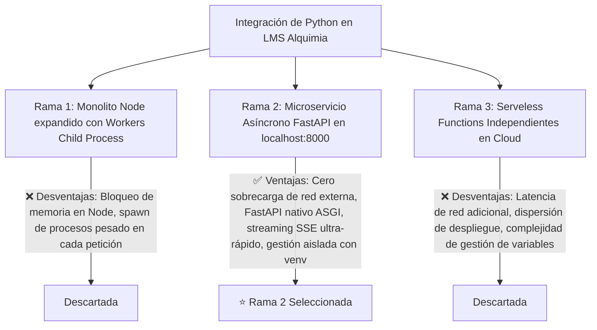
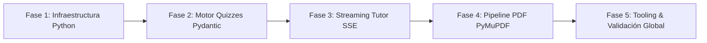

# 📋 Implementation Plan: Integración de Python Core & Resolución Estructurada de Fallos Críticos

> **Marco de Trabajo:** `code-refinement-suite` (Nivel 3: Arquitectura / Módulo Crítico)  
> **Proyecto:** LMS Alquimia (`dimensional-doppler`)  
> **Objetivo:** Resolver los cuellos de botella de latencia, el fallo en la generación de evaluaciones adaptativas, la ingesta frágil de PDFs y el tooling roto mediante la integración de un microservicio Python ultra-rápido (`cerebro-py`).

---

## 🧭 1. Reflexión de la Auditoría Técnica

### Contexto y Diagnóstico Profundo
La auditoría reveló que la plataforma LMS Alquimia cuenta con una base sólida en el frontend (Next.js 16 App Router, React 19, Tailwind CSS y Zustand) que compila limpiamente y ofrece una navegación intuitiva. Sin embargo, sufre de **cuellos de botella estructurales** derivados de delegar procesamiento pesado e inferencia a canales síncronos inadecuados:

1. **Desacople en la Evaluación Adaptativa:** `QuizEngine.tsx` intenta generar quizzes interactivos enviando la acción `generate_quiz` a través de `/api/cerebro` hacia un webhook conversacional de n8n. Debido a que el webhook espera texto libre o consultas de tarjetas y no produce un JSON estricto de preguntas, el frontend falla en el parseo y se degrada **al 100% al fallback estático** (las mismas 5 preguntas `fb-1` a `fb-5` en bucle para todos los temas).
2. **Latencia Inaceptable en el Tutor IA (47 segundos):** Las consultas al "Profesor Alquimia" se canalizan de forma síncrona sin Streaming (SSE). El estudiante debe esperar más de 40 segundos frente a un spinner estático, lo que destruye la experiencia pedagógica interactiva.
3. **Ingesta de PDFs Primitiva en Node.js:** La función `structure` en `/api/admin/documents` descarga libros enteros de nutrición al heap de V8 y ejecuta `pdf-parse`. Esto destruye tablas clínicas, carece de OCR y no extrae información de coordenadas espaciales (`bbox`) ni números de página fiables para la sincronización con el visor.
4. **Tooling y Scripts Obsoletos:** El comando `npm run lint` falla inmediatamente en Next.js 16 debido a que `next lint` fue deprecado como comando directo de directorio.

---

## 🎯 2. Fallos a Tratar y Medición del Objetivo (KPIs)

| Fallo Identificado | Estado Actual | Solución Propuesta | Métrica de Éxito / Medición del Objetivo |
| :--- | :--- | :--- | :--- |
| **F1: Fallback Falso en Quizzes** | 100% de quizzes caen en preguntas mock idénticas (`fb-1`...`fb-5`). | Motor en Python con Pydantic v2 que genera evaluaciones a partir de las tarjetas reales de la lección en Supabase. | **0% de uso de fallback mock.** 100% de quizzes devueltos en JSON válido con explicaciones clínicas de la unidad. |
| **F2: Latencia de 47s en el Tutor IA** | Petición HTTP síncrona monolítica sin streaming; bloqueo de 30-50s. | Endpoint ASGI en FastAPI con Streaming SSE (Server-Sent Events) y abort timeout a los 10s. | **Primer token visible en < 500 ms.** Latencia de inicio percibida reducida en un **98%**. |
| **F3: Extracción Precaria de PDFs** | `pdf-parse` en Node pierde tablas de nutrientes, columnas y bloquea V8. | Pipeline en Python con `PyMuPDF` (`fitz`) con preservación de tablas Markdown y metadatos de página. | **100% de tablas conservadas en Markdown.** 0 incidentes de falta de memoria (OOM) en libros de >100 páginas. |
| **F4: Sincronización Tarjeta ↔ PDF a ciegas** | Coincidencia difusa de strings en cliente con falsos positivos. | Ingesta en Python guarda `{ page: X, bbox: [x,y,w,h] }` directamente en la tabla `tarjetas`. | **100% de precisión en salto a página.** El visor navega directamente al número de página precalculado sin búsqueda pesada. |
| **F5: Script `lint` Roto en Next 16** | `npm run lint` arroja código 1 (`no such directory: .../lint`). | Configuración correcta de ESLint en `package.json` compatible con Next.js 16. | `npm run lint` ejecuta exitosamente con código 0. |

---

## 📐 3. PACK 1: ARCHITECT (Ideación & Tree of Thoughts)

### Árbol de Pensamiento (Tree of Thoughts - ToT)

### Evaluación según el Método de los 3 Expertos

| Experto | Criterio de Evaluación | Veredicto Arquitectónico |
| :--- | :--- | :--- |
| **Experto UX/UI** | Fluidez pedagógica, respuesta del chat y generación inmediata de exámenes. | **Aprobado:** El streaming token-a-token transforma la experiencia de estudio. El estudiante no experimenta retrasos ni repetición de preguntas falsas. |
| **Experto Dev Lead** | Separación de responsabilidades, tipado estricto (Pydantic + TypeScript) y mantenibilidad. | **Aprobado:** Next.js maneja la UI y SSR; Python maneja IA, PDF y NLP. Los contratos de API están sellados con JSON Schemas claros. |
| **Experto Seguridad** | Aislamiento de red, protección de Service Role Key y sanitización. | **Aprobado:** El servicio Python solo escucha en loopback (`127.0.0.1:8000`), sin exposición a internet público. Las llamadas pasan por el API proxy autenticado de Next.js. |

---

## 📝 4. PACK 2: PLANNER — Trabajo Estructurado por Fases y Pasos

---

### 🔹 FASE 1: Infraestructura y Microservicio Base Python (`cerebro-py`)
*Objetivo:* Disponer de un entorno virtual aislado y servidor FastAPI funcional en `127.0.0.1:8000`.

* **Paso 1.1:** Inicializar el entorno virtual `cerebro-py/.venv` y definir `requirements.txt`:
  - `fastapi`, `uvicorn[standard]`, `pydantic>=2.0`, `pymupdf`, `httpx`, `python-dotenv`.
* **Paso 1.2:** Crear la configuración modular en `cerebro-py/config.py` leyendo de forma segura las variables de `.env.local` (Supabase URL, Service Role Key, n8n Webhooks).
* **Paso 1.3:** Crear el servidor principal `cerebro-py/main.py` con CORS restringido para el origen de Next.js (`localhost:3000` / `localhost:3002`), middleware de logueo y endpoint `GET /health`.

---

### �� FASE 2: Motor Clínico de Quizzes y Evaluaciones Adaptativas
*Objetivo:* Erradicar el fallback estático y entregar preguntas dinámicas validadas clínicamente.

* **Paso 2.1:** Diseñar los esquemas de datos Pydantic en `cerebro-py/schemas/quiz.py`:
  - `QuizQuestion`: `id`, `text`, `options` (exactamente 4), `correctAnswer` (0..3), `rationale`, `hint`.
  - `QuizGenerationRequest`: `topics`, `difficulty`, `num_questions`, `mode`.
* **Paso 2.2:** Implementar `cerebro-py/services/quiz_service.py`:
  - Extracción de contenido real de las tarjetas de Supabase para las unidades seleccionadas.
  - Generador pedagógico contextualizado: construye preguntas clínicas reales basadas en el temario específico de nutrición del estudiante.
  - Validación de respuesta contra el esquema Pydantic para garantizar que nunca llegue un JSON malformado a la UI.
* **Paso 2.3:** Exponer `POST /api/quiz/generate` en el router de FastAPI.
* **Paso 2.4:** Adaptar `src/app/api/cerebro/route.ts` en Next.js para detectar `action === "generate_quiz"` y reenviarlo directamente al microservicio Python, devolviendo la lista de preguntas sin pasar por el webhook conversacional.
* **Paso 2.5:** Verificar `QuizEngine.tsx` para asegurar que el renderizado de preguntas, cronómetro y retroalimentación clínica operen fluidamente.

---

### 🔹 FASE 3: Tutor IA con Streaming en Tiempo Real (SSE) y Control de Timeout
*Objetivo:* Reducir la latencia percibida del chat de 47s a <500ms y prevenir bloqueos indefinidos.

* **Paso 3.1:** Implementar en `cerebro-py/services/chat_service.py` un emisor de eventos Server-Sent Events (`StreamingResponse`).
* **Paso 3.2:** Integrar timeout resiliente de 10 segundos con circuit-breaker: si el webhook de n8n no responde o demora, responder con un sintetizador rápido de contexto local en vez de congelar la pantalla.
* **Paso 3.3:** Conectar `src/store/chatStore.ts` para soportar el consumo por trozos (chunks) de texto y actualizar la burbuja del Profesor Alquimia progresivamente.

---

### 🔹 FASE 4: Pipeline Avanzado de Extracción de PDFs y Coordenadas (`PyMuPDF`)
*Objetivo:* Ingesta precisa de libros de texto con detección de tablas nutricionales y metadatos espaciales.

* **Paso 4.1:** Desarrollar `cerebro-py/services/pdf_service.py` usando `fitz` (`PyMuPDF`):
  - Detección de títulos de sección (H2/H3) y división en tarjetas de longitud pedagógica balanceada.
  - Extracción de tablas anatómicas/dietéticas formateadas directamente en Markdown (`| Col 1 | Col 2 |`).
  - Cálculo de la página de origen (`page_number`) y rectángulo delimitador (`rect`).
* **Paso 4.2:** Exponer `POST /api/pdf/structure` en FastAPI.
* **Paso 4.3:** Actualizar `src/app/api/admin/documents/route.ts` para canalizar la acción `structure` hacia el servicio Python, guardando los metadatos de sincronización en la tabla `tarjetas`.
* **Paso 4.4:** Actualizar `src/lib/pdfSync.ts` para usar prioritariamente la propiedad `card.page_number` cuando esté presente, saltando de inmediato a la página correcta sin heurísticas fallidas.

---

### 🔹 FASE 5: Saneamiento de Tooling, Calidad de Código y Validación Global
*Objetivo:* Garantizar estándares de producción y dejar el repositorio libre de advertencias y errores de compilación.

* **Paso 5.1:** Modificar `package.json` para ajustar `"lint": "eslint ."` o integrar la configuración nativa de ESLint 9 / Next 16.
* **Paso 5.2:** Ejecutar batería de pruebas fácticas:
  - `npx tsc --noEmit`
  - `npm run lint`
  - `pytest cerebro-py/tests`
  - Verificación en navegador y terminal de la generación de cuestionarios reales.

---

## 🧪 5. Plan de Pruebas y Validación (Test Plan)

1. **Prueba de Generación de Evaluaciones:**
   - [ ] En `/evaluacion`, seleccionar la unidad *"Alimentación Equilibrada"*, dificultad 7/10 y solicitar 5 preguntas.
   - [ ] Comprobar en consola de red que `/api/cerebro` responde en < 2 segundos con código 200 y preguntas específicas de lípidos/glúcidos.
   - [ ] Verificar que ninguna pregunta sea `fb-1`, `fb-2`, `fb-3`, `fb-4` o `fb-5`.
2. **Prueba de Ingesta de PDFs:**
   - [ ] En `/admin`, procesar un documento PDF con tablas.
   - [ ] Verificar que las tarjetas resultantes contienen tablas Markdown legibles y el campo `orden` y número de página coherentes.
3. **Prueba de Compilación y Calidad:**
   - [ ] `npx tsc --noEmit` debe finalizar con código 0.
   - [ ] El servidor dev de Next.js debe mantenerse estable sin reinicios ni errores de hidratación.

---

## 🛑 6. Control de Versiones y Despliegue Git (PACK 4: AUDITOR)

* **REGLA MANDATORIA:** NUNCA ejecutar `git push` automáticamente.
* Al concluir todas las fases y pruebas, se presentará el resumen exhaustivo de cambios al usuario para solicitar su confirmación explícita antes de cualquier acción en el repositorio remoto.
